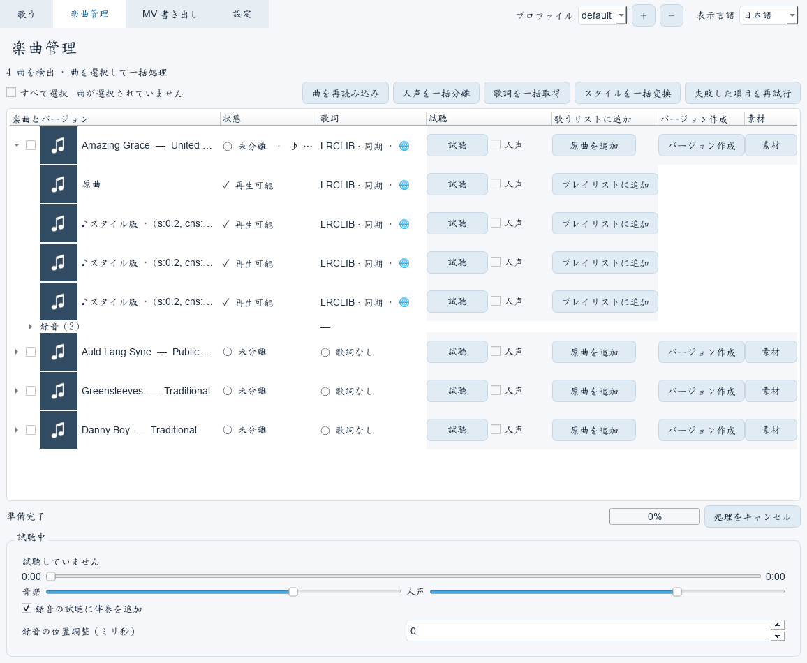
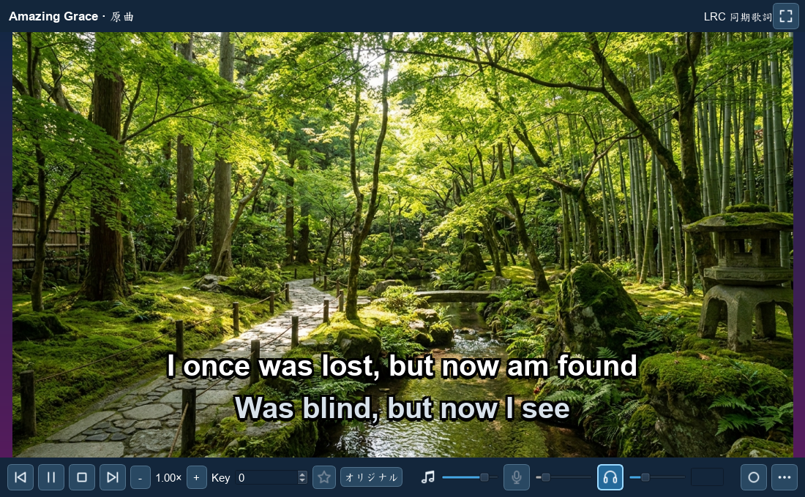

  
  <h1>KaraMorph · カラモーフ</h1>
  
KaraMorph AIで、いつもの曲を新しいスタイルへ。

  
好きな曲、好きなスタイル、あなただけの歌唱プレイリスト。

[English](README.md) · [繁體中文](README.zh-TW.md) · [日本語](README.ja.md)

歌いたい曲がカラオケに入っていない、いつもの曲を違うジャンルで歌ってみたい。KaraMorph は、そんな「自分好みに歌う」ための Windows 向けカラオケアプリです。繁体字中国語・英語・日本語の UI に対応しています。

### 楽曲の処理

### カラオケ再生

デモ曲：<a href="https://commons.wikimedia.org/wiki/File:Amazing_Grace_US_Marine_Band.ogg">Amazing Grace — United States Marine Band</a>。Wikimedia Commons では、この録音と John Newton による原版の英語歌詞はパブリックドメインとされています。

## 主な機能と特長

- **手持ちの MP3 をカラオケ音源に**：ボーカルを自動で分離し、そのまま歌える伴奏を作成します。[詳細](docs/KARAOKE_TRACKS.ja.md)
- **AI でアレンジ変更**：同じ曲を別のスタイル（例：ラウンジジャズ）に変更できます。[詳細](docs/STYLE_VERSIONS.ja.md)
- **歌詞**：歌詞を自動検索、または自分で入力・貼り付けできます。[詳細](docs/LYRICS.ja.md)
- **歌詞タイミング調整**：音楽に合わせてスペースキーを押し、テキスト歌詞を1行ずつの LRC にしたり、既存の LRC を調整したりできます。[詳細](docs/LYRIC_TIMING.ja.md)
- **MV の書き出し**：曲のバージョンや自分の録音に、字幕と背景画像を合わせて MP4 に書き出せます。[詳細](docs/MV_EXPORT.ja.md)
- **背景画面**：歌唱中の背景画像用の検索キーワードを自動生成し、ドラッグ＆ドロップで曲ごとに背景を設定できます。[詳細](docs/BACKGROUNDS.ja.md)
- **深度背景アニメーション（実験）**：静止画像の一部を歌唱中や MV 出力時に動かせます。事前処理や動きの調整にも対応します。[詳細](docs/DEPTH_ANIMATION.ja.md)
- **リアルタイム調整**：歌唱中に速度（0.7–1.3倍）とキー（±6半音）を変更でき、曲ごとにマイベストを記憶できます。[詳細](docs/SUPPLEMENTARY.ja.md#再生速度とキー)
- **プレイリストと録音**：自分だけの歌唱プレイリストを作り、マイクで歌声を録音できます。[詳細](docs/SINGING_RECORDING.ja.md)
- **プロファイル**：右上でプロファイルを追加・切り替え（ZIP で別の PC へ移行も可能）でき、人（や用途）ごとに音量設定・プレイリスト・ベスト設定・録音を分けられます。[詳細](docs/PROFILES.ja.md)

## 動作確認環境

- Windows 11
- NVIDIA GeForce RTX 3050 Ti Laptop GPU（VRAM 4 GB）
- RAM 40 GB

## クイックスタート

MP3 を1曲ジャズ風の伴奏に変えて、歌うプレイリストに追加する例です。プログラミングや Python のインストールは不要です。

1. **ダウンロード**：[Releases](https://github.com/yceugenelai/KaraMorph/releases) を開き、使いたいバージョンの **Assets** を展開して `KaraMorph-bootstrap-poc.zip` をダウンロードします。
2. **展開して起動**：ZIP を右クリック →「すべて展開」で書き込み可能なフォルダー（例：デスクトップ）へ展開し、`KaraMorph.exe` をダブルクリックします。ZIP 内や Program Files 内では実行しないでください。
3. **初回セットアップ**：表示言語を選び、人声分離と ACE-Step を選択したまま準備を開始します。インターネットに接続した状態で、キャッシュ込みで約35～40 GiBの空き容量が必要です。
4. **input フォルダーを設定**：`KaraMorph.exe` と同じフォルダー内に `input` フォルダーを作成します。「設定」の「音楽フォルダー」で「選択…」からこのフォルダーを選び、「設定を保存」を押します。
5. **曲を1つ追加**：使用する権利のある MP3 を `input` へコピーし、「楽曲管理」で「曲を再読み込み」を押します。
6. **人声を分離**：曲を選択して「人声を一括分離」を押します。完了後、曲を展開すると「伴奏のみ」が表示されます。
7. **歌詞を取得**：曲を選択したまま「歌詞を一括取得」を押します。見つからない場合は、その曲の「素材」から手動で検索するか、自分の歌詞を追加できます。歌詞がなくても再生できます。
8. **好きなスタイルに変更**：曲の「バージョン作成」を押し、「スタイル」で「ラウンジジャズ」を選び、「スタイル版を作成」を押して完了を待ちます（AI 処理には時間がかかる場合があります）。
9. **プレイリストに追加**：曲を展開し、完成した版（または「伴奏のみ」）の「プレイリストに追加」を押します。
10. **歌い始める**：「歌う」タブで曲を選び、「再生」を押します。リストを残すには「プレイリストを保存」を押してください。

必要な権利を取得した音楽・歌詞・画像のみを使用してください。詳しくは下記の[ライセンスと法的注意](docs/SUPPLEMENTARY.ja.md#ライセンスと法的注意)を参照してください。

## ライセンス

KaraMorph 独自のソースは [MIT](LICENSE) です。依存パッケージ、モデル、ネイティブ実行ファイルには別の条件があります。音源とモデルの重みは同梱しません。配布範囲や素材の出典は[補足情報](docs/SUPPLEMENTARY.ja.md)を参照してください。

メンテナーのウェブサイト：[OpticalPivot](https://www.opticalpivot.net/)。

## 詳細情報

詳しい内容は docs フォルダーにあります：

- [ライセンスと法的注意](docs/SUPPLEMENTARY.ja.md#ライセンスと法的注意)
- [背景画像](docs/SUPPLEMENTARY.ja.md#背景画像)
- [初回セットアップ](docs/SUPPLEMENTARY.ja.md#初回セットアップ)
- [ハードウェアとプラットフォーム](docs/SUPPLEMENTARY.ja.md#ハードウェアとプラットフォーム)
- [再生速度とキー](docs/SUPPLEMENTARY.ja.md#再生速度とキー)
- [楽曲一覧とデータの場所](docs/SUPPLEMENTARY.ja.md#楽曲一覧とデータの場所)
- [ユーザーデータの移行](docs/SUPPLEMENTARY.ja.md#ユーザーデータの移行)
- [軽量 ZIP のビルド](docs/SUPPLEMENTARY.ja.md#軽量-zip-のビルド)
- [開発](docs/SUPPLEMENTARY.ja.md#開発)
