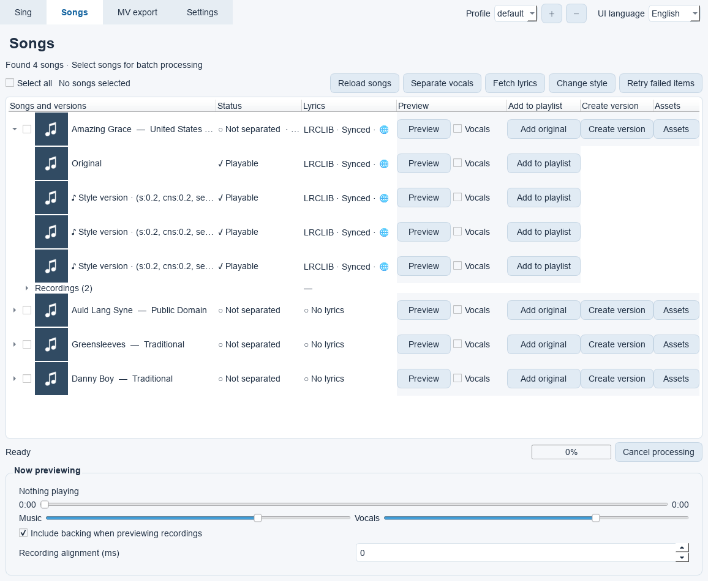
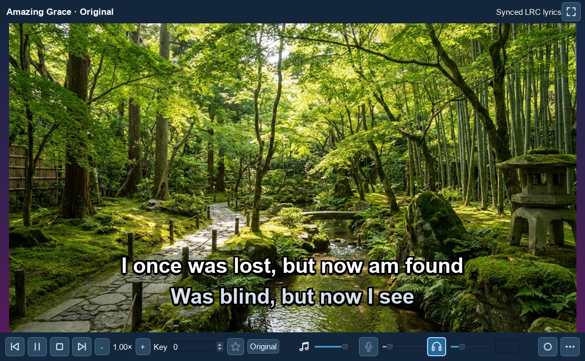

  
  <h1>KaraMorph · カラモーフ</h1>
  
KaraMorph — Transform the style. Keep the song.

  
Your favorite songs. Your favorite styles. Your own singing playlist.

[English](README.md) · [繁體中文](README.zh-TW.md) · [日本語](README.ja.md)

Can't find the song you want in the karaoke catalog? Want to hear a familiar song in a different style? KaraMorph is a Windows karaoke app that gives you a little more room for personal choice. The UI supports Traditional Chinese, English and Japanese.

### Song processing

### Karaoke playback

Screenshot demo: <a href="https://commons.wikimedia.org/wiki/File:Amazing_Grace_US_Marine_Band.ogg">Amazing Grace — United States Marine Band</a>. Wikimedia Commons identifies the recording and John Newton’s original English lyrics as public domain.

## Features

- **Your own MP3s as karaoke tracks**: vocals are separated automatically, giving you a backing track ready to sing over. [Details](docs/KARAOKE_TRACKS.md)
- **AI re-arrangement**: turn the same song into a different style (for example, lounge jazz). [Details](docs/STYLE_VERSIONS.md)
- **Lyrics**: search lyrics automatically, or type or paste your own. [Details](docs/LYRICS.md)
- **Lyric timing**: tap Space along with the music to turn plain text into a line-by-line LRC, or re-time an existing one. [Details](docs/LYRIC_TIMING.md)
- **Create an MV**: combine a song version or your own recording with subtitles and background images, and export an MP4. [Details](docs/MV_EXPORT.md)
- **Backgrounds**: keywords are generated automatically to search for background images while you sing; simple drag and drop assigns a background to each song. [Details](docs/BACKGROUNDS.md)
- **Depth background animation (experimental)**: animate regions of still images during karaoke and MV export, with optional preprocessing and adjustable motion. [Details](docs/DEPTH_ANIMATION.md)
- **Live adjustment**: change speed (0.7–1.3×) and key (±6 semitones) while singing, and remember your best setting for each song. [Details](docs/SUPPLEMENTARY.md#playback-speed-and-key)
- **Playlists and recording**: build your own singing playlist and record your performance with a microphone. [Details](docs/SINGING_RECORDING.md)
- **Profiles**: add or switch profiles at the top right (and move them to another computer as a ZIP), so each person (or purpose) keeps their own volume preferences, playlist, best settings and recordings. [Details](docs/PROFILES.md)

## Tested environment

- Windows 11
- NVIDIA GeForce RTX 3050 Ti Laptop GPU (4 GB VRAM)
- 40 GB RAM

## Quick start

This example turns one MP3 into a jazz backing track, then adds it to your singing playlist. No coding or Python installation is needed.

1. **Download**: Open [Releases](https://github.com/yceugenelai/KaraMorph/releases), expand **Assets** under the version you want, and download `KaraMorph-bootstrap-poc.zip`.
2. **Extract and launch**: Right-click the ZIP → **Extract All** into a writable folder (for example, on your desktop), then double-click `KaraMorph.exe`. Do not run it inside the ZIP or Program Files.
3. **Complete first-run setup**: Choose your UI language, keep vocal separation and ACE-Step selected, and start preparation. Stay connected to the internet; allow roughly 35–40 GiB including download caches.
4. **Choose an input folder**: Create a folder named `input` beside `KaraMorph.exe`. In **Settings**, click **Browse…** beside **Music folder**, select it, then click **Save settings**.
5. **Add one song**: Copy an MP3 you are authorized to use into `input`, then open **Songs** and click **Reload songs**.
6. **Separate vocals**: Check the song and click **Separate vocals**. When it finishes, expand the song to find **Backing only**.
7. **Find lyrics**: Keep the song checked and click **Fetch lyrics**. If none are found, click the song's **Assets** to search manually or add your own. Playback also works without lyrics.
8. **Change the style**: Click **Create version** beside the song, choose **Lounge Jazz** under **Style**, then click **Create style versions** and wait (AI processing can take a while).
9. **Add to your playlist**: Expand the song and click **Add to playlist** beside the finished version (or beside **Backing only**).
10. **Start singing**: Open **Sing**, select the song and click **Play**. Click **Save playlist** to keep your list.

Use only songs, lyrics and images you are authorized to use. See [License and legal notice](docs/SUPPLEMENTARY.md#license-and-legal-notice) below.

## License

KaraMorph's own source is [MIT](LICENSE); dependencies, models and native binaries have separate terms. No audio tracks or model weights are supplied. For distribution and asset provenance, see [Supplementary information](docs/SUPPLEMENTARY.md).

Maintained by [OpticalPivot](https://www.opticalpivot.net/).

## More information

Details are kept in the docs folder:

- [License and legal notice](docs/SUPPLEMENTARY.md#license-and-legal-notice)
- [Background images](docs/SUPPLEMENTARY.md#background-images)
- [First-run setup](docs/SUPPLEMENTARY.md#first-run-setup)
- [Hardware and platform](docs/SUPPLEMENTARY.md#hardware-and-platform)
- [Playback speed and key](docs/SUPPLEMENTARY.md#playback-speed-and-key)
- [Song library and data locations](docs/SUPPLEMENTARY.md#song-library-and-data-locations)
- [Moving user data](docs/SUPPLEMENTARY.md#moving-user-data)
- [Build the lightweight ZIP](docs/SUPPLEMENTARY.md#build-the-lightweight-zip)
- [Development](docs/SUPPLEMENTARY.md#development)
