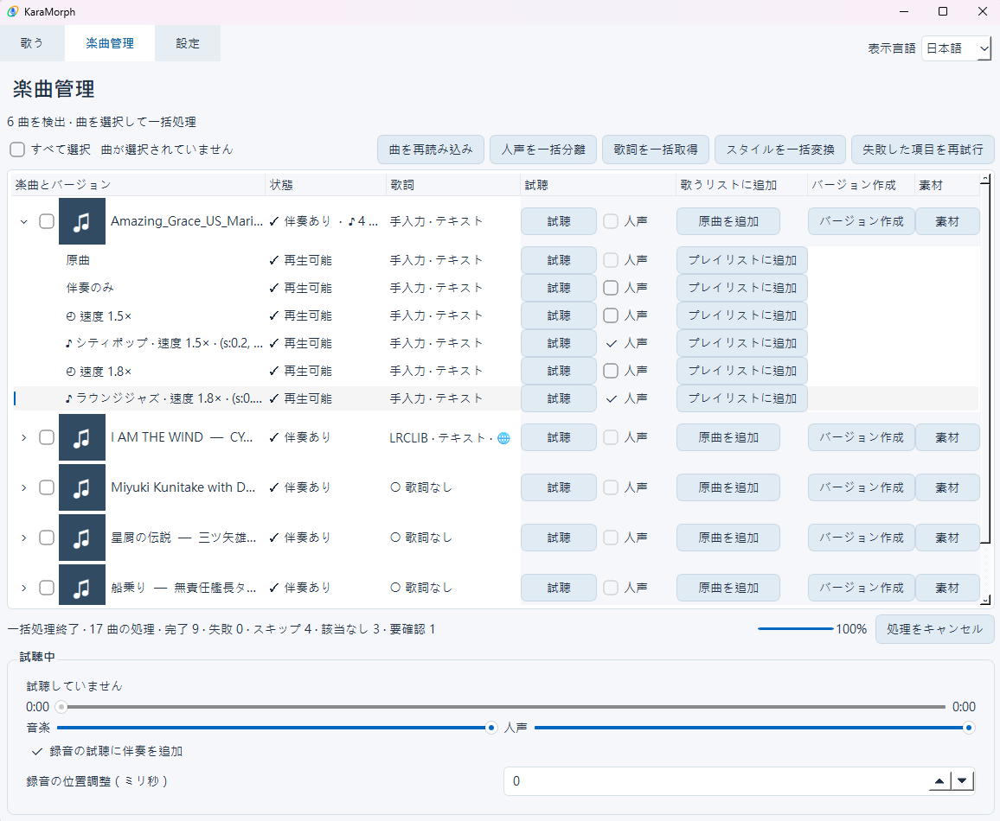
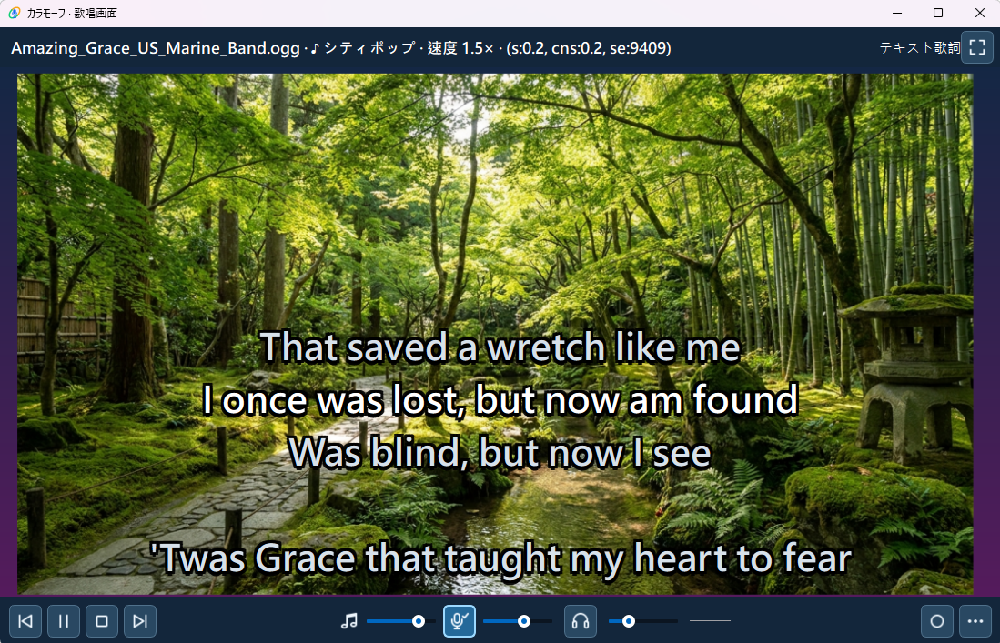

<div align="center">
  
  <h1>KaraMorph · カラモーフ</h1>
  <p>KaraMorph — Transform the style. Keep the song.</p>
  <p>Your favorite songs. Your favorite styles. Your own singing playlist.</p>
</div>

[English](README.md) · [繁體中文](README.zh-TW.md) · [日本語](README.ja.md)

Can't find the song you want in the karaoke catalog? Want to hear a familiar song in a different style? KaraMorph is a Windows karaoke app that gives you a little more room for personal choice. The UI supports Traditional Chinese, English and Japanese.

### Song processing



### Karaoke playback



<sub>Screenshot demo: <a href="https://commons.wikimedia.org/wiki/File:Amazing_Grace_US_Marine_Band.ogg">Amazing Grace — United States Marine Band</a>. Wikimedia Commons identifies the recording and John Newton’s original English lyrics as public domain.</sub>

## Features

- **Your own MP3s as karaoke tracks**: vocals are separated automatically, giving you a backing track ready to sing over.
- **AI re-arrangement**: turn the same song into a different style (for example, lounge jazz).
- **Lyrics**: search lyrics automatically, or type or paste your own.
- **Backgrounds**: keywords are generated automatically to search for background images while you sing; simple drag and drop assigns a background to each song.
- **Live adjustment**: change speed (0.7–1.3×) and key (±6 semitones) while singing.
- **Playlists and recording**: build your own singing playlist and record your performance with a microphone.

## Tested environment

- Windows 11
- NVIDIA GeForce RTX 3050 Ti Laptop GPU (4 GB VRAM)
- 40 GB RAM

## Quick start

This example turns one MP3 into a jazz backing track, then adds it to your singing playlist. No coding or Python installation is needed.

1. **Download**: Open [Releases](https://github.com/yceugenelai/KaraMorph/releases), expand **Assets** under the version you want, and download `KaraMorph-bootstrap-poc.zip`.
2. **Extract and launch**: Right-click the ZIP → **Extract All** into a writable folder (for example, on your desktop), then double-click `KaraMorph.exe`. Do not run it inside the ZIP or Program Files.
3. **Complete first-run setup**: Choose your UI language, keep vocal separation and ACE-Step selected, and start preparation. Stay connected to the internet; allow roughly 35–40 GiB including download caches.
4. **Choose an input folder**: Create a folder named `input` beside `KaraMorph.exe`. In **Settings**, click **Browse…** beside **Music folder**, select it, then click **Save settings**.
5. **Add one song**: Copy an MP3 you are authorized to use into `input`, then open **Songs** and click **Reload songs**.
6. **Separate vocals**: Check the song and click **Separate vocals**. When it finishes, expand the song to find **Backing only**.
7. **Find lyrics**: Keep the song checked and click **Fetch lyrics**. If none are found, click the song's **Assets** to search manually or add your own. Playback also works without lyrics.
8. **Change the style**: Click **Create version** beside the song, choose **Lounge Jazz** under **Style**, then click **Create style versions** and wait (AI processing can take a while).
9. **Add to your playlist**: Expand the song and click **Add to playlist** beside the finished version (or beside **Backing only**).
10. **Start singing**: Open **Sing**, select the song and click **Play**. Click **Save playlist** to keep your list.

Use only songs, lyrics and images you are authorized to use. See [License and legal notice](#license-and-legal-notice) below.

## License

KaraMorph's own source is [MIT](LICENSE); dependencies, models and native binaries have separate terms. No audio tracks or model weights are supplied. For distribution and asset provenance, see [Supplementary information](#supplementary-information).

Maintained by [OpticalPivot](https://www.opticalpivot.net/).

---

## Supplementary information

### License and legal notice

Personal use does not automatically grant permission. Publishing modified music can require reproduction, adaptation, public-performance/public-transmission and recording-related permissions, depending on applicable law. LRCLIB availability does not itself grant redistribution permission.

- The lightweight ZIP's [distribution scope and artifact check](docs/DISTRIBUTION.md)
- Screenshot and visual asset provenance: [asset credits](docs/ASSET_CREDITS.md), [visual asset license scope](assets/ASSET_LICENSE.md)
- Icons were generated using OpenAI ChatGPT; shared backgrounds were generated using paid Nano Banana Pro in Google AI Studio. The screenshots are actual app captures.
- Code and the four shared backgrounds are MIT. Icons remain rights-reserved KaraMorph branding assets; screenshot content has its own rights.
- Development of KaraMorph was assisted by OpenAI ChatGPT and Codex.

### Background images

The default shared backgrounds folder is `outputs/shared_images/` (under your selected output directory if changed). The included backgrounds are copied on first use. Add your own images there; existing user images and deleted defaults are respected. [Adding backgrounds](assets/README.md).

### First-run setup

No installed Python or Git is required. Choose English, Traditional Chinese or Japanese. On the first launch English is selected; later launches use your saved language. Vocal separation and ACE-Step are selected by default: setup prepares their Python environments, models and pinned ACE-Step source in this folder. The small ZIP size does not represent the installed size.

Optional features can be unchecked. Basic playback and live speed/key adjustments work without AI models; first-run setup downloads and verifies SoundTouch. Creating saved speed/key versions still requires the ACE-Step runtime. Completed components are kept if preparation fails or is cancelled. Retry, or start with the available features. Settings → Manage installation can add features later; normal launches do not install previously unchecked features. [Setup and build details](docs/BOOTSTRAP.md).

**Model and component management** shows SoundTouch's installation and verification status and lets you download or repair it independently of the AI models.

### Hardware and platform

NVIDIA CUDA is preferred for AI processing. Long tracks or insufficient VRAM can use CPU after confirmation; CPU styling is slow and needs substantial RAM. AMD/Intel GPU acceleration is not supported in this preview. Windows 11 x64 is the primary target; audio devices and drivers vary. WASAPI exclusive output can prevent other apps from using the same device.

### Playback speed and key

Speed −/+ buttons change it by 0.1×; **More settings → Playback speed / key** retains the slider for fine adjustments and a reset button for speed and key. Changes affect the current music version and guide vocals; microphone monitoring and dry recordings stay unchanged. Each song starts with neutral settings, and lyrics follow its source position. Whole-song recordings additionally save the backing actually played as a WAV for synchronized preview, using extra disk space. Both shared and exclusive playback support this feature; it does not create a new song version.

### Song library and data locations

The processing library follows the actual music folder. Click Reload songs after adding, removing or moving files. Missing originals disappear from this list; generated audio, recordings and assets remain on disk. Existing playlist items stay marked unavailable until their original source returns. There is no persistent song blacklist.

Settings, playlists, logs and caches live in `.app_data/`; models in `models/`; processed audio in `outputs/`. Output and model locations can be selected in the UI. Language changes require restart. Updates are manual: keep your data folders and replace application files after backup. See [known limits](docs/RELEASE.md).

### Moving user data

You can change the application folder, but **copying music and outputs to different paths does not reliably preserve links to existing versions, recordings and playlists**. Song IDs include the original audio's full path, size and modification time; generated audio also uses absolute paths.

For a freshly extracted version on the same PC, keep the existing data locations:

1. Close both versions and back up your data. Keep the original music folder and the entire output folder (default: `outputs/`).
2. Copy the old `.app_data/settings.json` and `last_playlist.json` into the new application's `.app_data/`, if present. Copy `logs/` if you want diagnostic history, and keep any separately saved playlist JSON files. Models, Python environments, caches and `model-receipts.json` are not needed.
3. Open the new app. In Settings, select the **original full paths** for the music and output folders, save settings, then click Reload songs.
4. Check originals, generated versions, recordings and playlists before removing old application files.

On another PC, use the same drive letters and full data paths, and preserve original audio filenames, contents and modification times. There is currently no automatic migration tool; keep your backup.

### Build the lightweight ZIP

On Windows 11 x64, open PowerShell in this source folder. Use a Python environment with PySide6 installed (see [Python setup and source execution](docs/DEVELOPMENT.md)):

```powershell
powershell -ExecutionPolicy Bypass -File scripts/build-bootstrap-poc.ps1 -UiPython C:\path\to\python.exe
```

The archive is `dist/KaraMorph-bootstrap-poc.zip`; runtimes, models and personal data are excluded. To rebuild an existing package, add `-Repack`. [Build details](docs/BOOTSTRAP.md).

### Development

For Python environment setup and running from source, see [the developer guide](docs/DEVELOPMENT.md).
