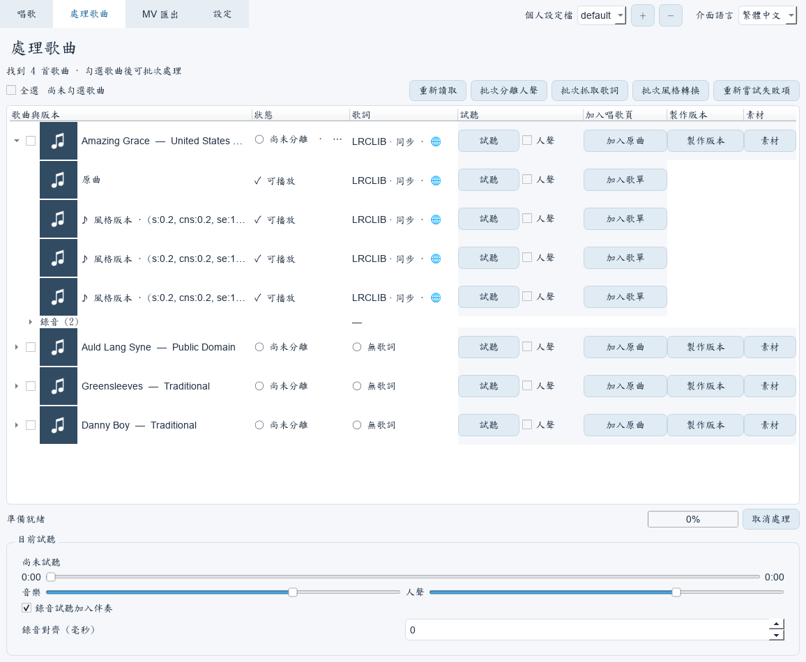
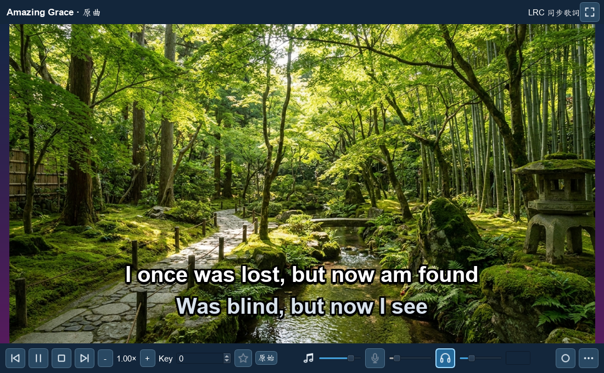

  
  <h1>KaraMorph · カラモーフ</h1>
  
用 AI，讓熟悉的歌曲唱出新的風格。

  
你喜愛的歌曲，你喜愛的風格，你專屬的歌唱清單。

[English](README.md) · [繁體中文](README.zh-TW.md) · [日本語](README.ja.md)

想唱的歌，卡拉 OK 偏偏沒收錄？或想換個曲風唱熟悉的歌？KaraMorph 是 Windows 卡拉 OK 應用程式，讓唱歌多一點自己的選擇。支援繁體中文、英文、日文介面。

### 歌曲處理

### 唱歌中

截圖示範曲：<a href="https://commons.wikimedia.org/wiki/File:Amazing_Grace_US_Marine_Band.ogg">Amazing Grace — United States Marine Band</a>。Wikimedia Commons 標示此錄音與 John Newton 原版英文歌詞為公有領域。

## 主要功能與特色

- **自己的 MP3 變卡拉 OK**：自動分離人聲，產生可直接演唱的伴奏。[詳細說明](docs/KARAOKE_TRACKS.zh-TW.md)
- **AI 重新編曲**：把同一首歌改成不同風格（例如酒廊爵士）。[詳細說明](docs/STYLE_VERSIONS.zh-TW.md)
- **歌詞**：自動搜尋歌詞，或手動輸入、貼上自己的歌詞。[詳細說明](docs/LYRICS.zh-TW.md)
- **字幕校正**：跟著音樂按空白鍵，把純文字歌詞變成逐句 LRC，或重新校正現有的 LRC。[詳細說明](docs/LYRIC_TIMING.zh-TW.md)
- **製作 MV**：選一個歌曲版本或自己的錄音，搭配字幕與背景圖，輸出成 MP4。[詳細說明](docs/MV_EXPORT.zh-TW.md)
- **背景畫面**：自動產生關鍵字搜尋唱歌時的背景圖，並可用簡單拖放為不同曲目指定背景。[詳細說明](docs/BACKGROUNDS.zh-TW.md)
- **深度背景動畫（實驗）**：讓靜態圖片的局部在唱歌和 MV 匯出時動起來，可預先處理圖片並調整動態。[詳細說明](docs/DEPTH_ANIMATION.zh-TW.md)
- **即時調整**：唱歌中可調整 0.7–1.3 倍速度與 ±6 半音 Key，並可為每首歌記住個人最佳設定。[詳細說明](docs/SUPPLEMENTARY.zh-TW.md#播放速度與-key)
- **歌單與錄音**：建立專屬歌單，並以麥克風錄下演唱。[詳細說明](docs/SINGING_RECORDING.zh-TW.md)
- **個人設定檔**：視窗右上角可新增或切換設定檔（可打包轉移到另一台電腦），不同人（或不同用途）各有自己的音量偏好、歌單、最佳設定與錄音。[詳細說明](docs/PROFILES.zh-TW.md)

## 測試環境

- Windows 11
- NVIDIA GeForce RTX 3050 Ti Laptop GPU（4 GB VRAM）
- 40 GB RAM

## 快速開始

以下以「把一首 MP3 變成爵士伴奏，再加入歌單唱歌」為例。不需要寫程式或安裝 Python。

1. **下載**：開啟 [Releases](https://github.com/yceugenelai/KaraMorph/releases)，在要使用的版本下展開 **Assets**，下載 `KaraMorph-bootstrap-poc.zip`。
2. **解壓並啟動**：對 ZIP 按右鍵 →「全部解壓縮」，放到可寫入的資料夾（如桌面），再雙擊 `KaraMorph.exe`。請勿直接在 ZIP 或 Program Files 內執行。
3. **完成首次安裝**：選擇介面語言，保留「人聲分離」與「ACE-Step」勾選，依畫面開始準備。需保持網路連線；含下載快取約需 35–40 GiB 空間。
4. **設定 input 資料夾**：在 `KaraMorph.exe` 所在資料夾建立 `input` 資料夾。進入「設定」，在「音樂資料夾」按「選擇…」選取它，再按「儲存設定」。
5. **放入一首歌**：將一首有權使用的 MP3 複製到 `input`，回到「處理歌曲」按「重新讀取」。
6. **分離人聲**：勾選歌曲，按「批次分離人聲」。完成後展開歌名即可看到「純伴奏」。
7. **找歌詞**：保持勾選，按「批次抓取歌詞」。找不到時，按該歌曲的「素材」手動搜尋或加入歌詞；沒有歌詞也能播放。
8. **改成喜歡的風格**：按歌曲右側的「製作版本」，「風格」選「酒廊爵士」，按「製作風格版本」並等待完成（AI 處理可能需要較長時間）。
9. **加入歌單**：展開歌曲，按完成版本（或「純伴奏」）右側的「加入歌單」。
10. **開始唱歌**：切到「唱歌」，選取歌曲，按「播放」。想保留歌單，按「儲存歌單」。

請使用已取得必要授權的歌曲、歌詞與影像，詳見下方[授權與法律提醒](docs/SUPPLEMENTARY.zh-TW.md#授權與法律提醒)。

## 授權

KaraMorph 自有原始碼採 [MIT](LICENSE)；相依套件、模型與原生執行檔有各自條款。不附音樂音檔與模型權重。其餘授權、散布與素材來源說明請見[補充資訊](docs/SUPPLEMENTARY.zh-TW.md)。

維護者網站：[OpticalPivot](https://www.opticalpivot.net/)。

## 更多說明

詳細內容放在 docs 資料夾：

- [授權與法律提醒](docs/SUPPLEMENTARY.zh-TW.md#授權與法律提醒)
- [背景圖片](docs/SUPPLEMENTARY.zh-TW.md#背景圖片)
- [首次啟動設定](docs/SUPPLEMENTARY.zh-TW.md#首次啟動設定)
- [硬體與平台](docs/SUPPLEMENTARY.zh-TW.md#硬體與平台)
- [播放速度與 Key](docs/SUPPLEMENTARY.zh-TW.md#播放速度與-key)
- [處理清單與資料位置](docs/SUPPLEMENTARY.zh-TW.md#處理清單與資料位置)
- [資料搬移](docs/SUPPLEMENTARY.zh-TW.md#資料搬移)
- [打包精簡版 ZIP](docs/SUPPLEMENTARY.zh-TW.md#打包精簡版-zip)
- [開發](docs/SUPPLEMENTARY.zh-TW.md#開發)
