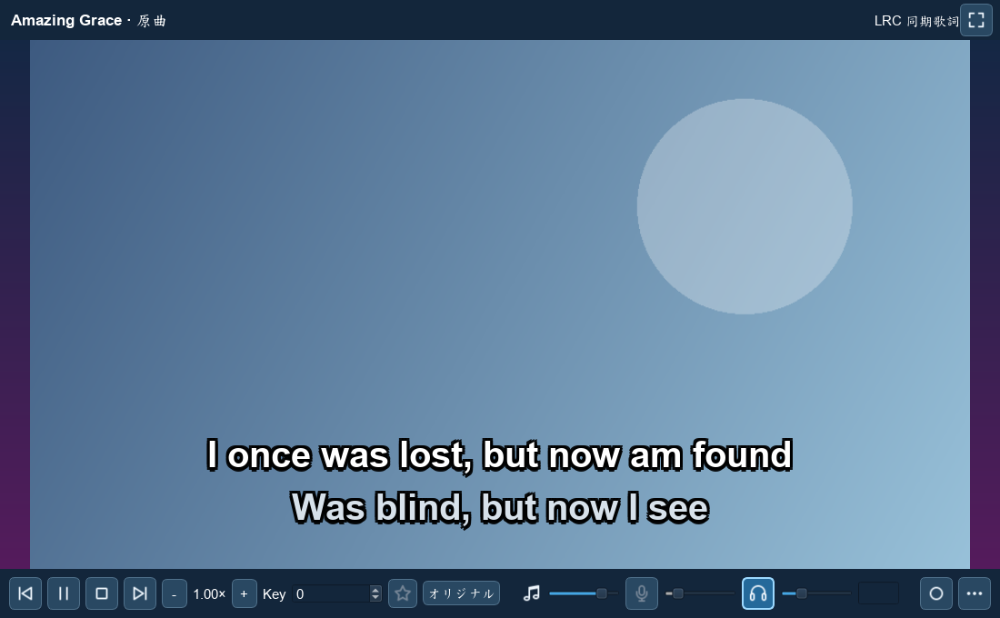

# 背景画面

[English](BACKGROUNDS.md) · [繁體中文](BACKGROUNDS.zh-TW.md) · [日本語](BACKGROUNDS.ja.md)

[README](../README.ja.md) に戻る

歌唱中の背景画像はランダムな順で切り替わります。曲ごとに自分の画像を追加することも、すべての曲で共有する画像を使うこともできます。
異なる背景画像の切り替えには約2秒のクロスフェードが使われ、再生を一時停止すると切り替えも停止します。

## 背景の取得元

「設定」の「カラオケ背景画像」で選びます：

- **楽曲の画像のみ**：音楽ファイルのアートワークと、その曲の画像フォルダー。
- **共通画像＋楽曲画像**（既定）：楽曲の画像に共通画像を加えます。
- **共通画像のみ**。

使える画像がない場合は `no images` と表示されます。「背景の微動作」をオンにすると、画像が少し拡大縮小・移動します（画像全体は表示されたままです）。

## 深度背景アニメーション（実験）

「設定 → モデルとコンポーネントの管理」で「背景深度アニメーション」を選び、不要な他のモデルの選択を外して Depth Anything V2 Small をダウンロードまたはインポートします（約 100 MB）。スタイル変換用の実行環境は必要ですが、ACE-Step モデルは不要です。設定で「背景の微動作」と「深度背景アニメーション（実験）」を有効にして保存します。

歌唱ウィンドウの上部に現在の背景モード、処理状態、適用中の A3 方式とマスク被覆率が表示されます。解析は別プロセスで実行され、結果はキャッシュされます。解析中や失敗時は通常の背景動作を使います。現在の画像の処理を最大約 25 秒待ち、完了後は結果を少なくとも約 5 秒表示してから切り替えます。領域の判定は推測に基づくため、意図しない部分が動くことがあります。初回処理が音声に影響する場合は機能をオフにしてください。MV の書き出しにも深度アニメーションを使用できます。

事前処理するには再生を停止し、「曲の処理」で曲にチェックを入れて「背景アニメーションを事前処理」を選ぶか、曲またはバージョンを右クリックします。現在の背景画像設定に従い、必要に応じて共通画像や音楽ファイルのカバーも処理します。曲の状態欄の緑色のアイコンはすべての画像が処理済み、橙色は一部が処理済みであることを示します。キャッシュを再利用でき、進捗と失敗は作業欄に表示され、処理をキャンセルできます。未処理の画像ごとにモデルプロセスを起動するため、画像が多い場合は時間がかかります。以前の版のキャッシュは再度事前処理すると、モデルを再実行せずに状態を索引化できます。

設定で「背景アニメーション設定」を開くと、動きの強さと速度、マスク被覆率、人物・風景のマスク拡張と不透明化を調整できます。マスク設定の変更には再処理が必要ですが、強さと速度の変更では既存のマスクを再利用します。

セットアップ、事前処理、MV 出力の手順は[深度背景アニメーション](DEPTH_ANIMATION.ja.md)を参照してください。

## 曲に画像を追加する

曲の「素材」→「画像」タブを開きます：

- **楽曲画像の選択**：画像を貼り付けまたはドロップすると、曲のフォルダーにコピーされます（元のファイルは変更されません）。一覧のサムネイルも選べます。
- **楽曲のネット画像検索**：キーワードには曲名とアーティストが入ります。既定のブラウザーで検索し、選んだ画像を上部の受け取りバーにドラッグまたは貼り付けます。
- **共通画像**：同じ操作ですが、画像は共有フォルダーに入り、すべての曲で使えます。

対応形式は JPG・PNG・WebP・BMP で、1枚あたり 20 MB 以内です。画像の削除やサムネイル設定は「保存」を押すと有効になります。

## 共有背景フォルダー

同梱の共有背景は初回利用時にコピーされます。自分の画像を追加したり既定画像を削除したりでき、ユーザーの画像が上書きされることはありません。場所と詳細は[背景画像](SUPPLEMENTARY.ja.md#背景画像)を参照してください。

## 関連

これらの画像は [MV の書き出し](MV_EXPORT.ja.md)でも使えます。使用する権利のある画像のみを使ってください。
