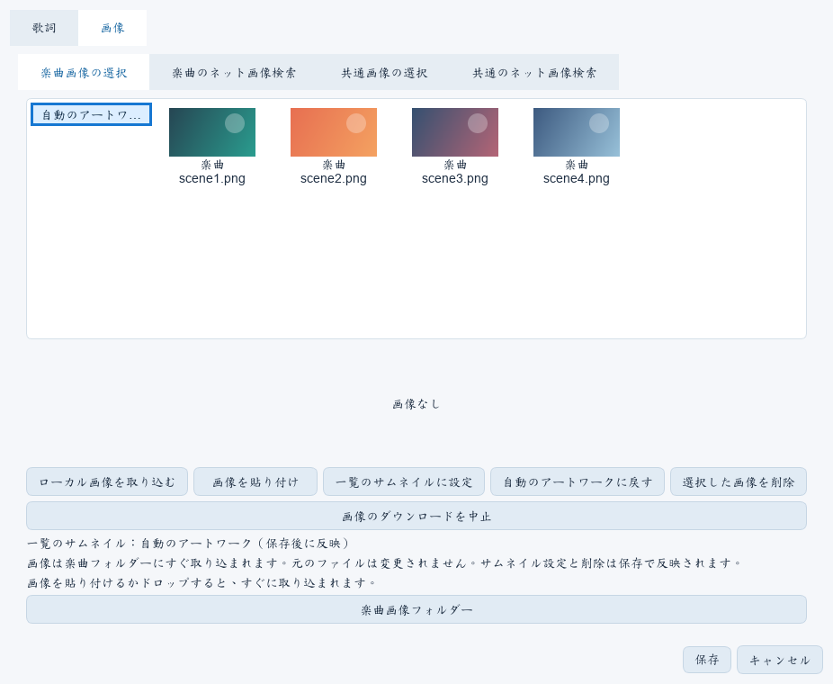

# 背景画面

[English](BACKGROUNDS.md) · [繁體中文](BACKGROUNDS.zh-TW.md) · [日本語](BACKGROUNDS.ja.md)

[README](../README.ja.md) に戻る

歌唱中の背景画像はランダムな順で切り替わります。曲ごとに自分の画像を追加することも、すべての曲で共有する画像を使うこともできます。

## 背景の取得元

「設定」の「カラオケ背景画像」で選びます：

- **楽曲の画像のみ**：音楽ファイルのアートワークと、その曲の画像フォルダー。
- **共通画像＋楽曲画像**（既定）：楽曲の画像に共通画像を加えます。
- **共通画像のみ**。

使える画像がない場合は `no images` と表示されます。「背景の微動作」をオンにすると、画像が少し拡大縮小・移動します（画像全体は表示されたままです）。

## 曲に画像を追加する

曲の「素材」→「画像」タブを開きます：

- **楽曲画像の選択**：画像を貼り付けまたはドロップすると、曲のフォルダーにコピーされます（元のファイルは変更されません）。一覧のサムネイルも選べます。
- **楽曲のネット画像検索**：キーワードには曲名とアーティストが入ります。既定のブラウザーで検索し、選んだ画像を上部の受け取りバーにドラッグまたは貼り付けます。
- **共通画像**：同じ操作ですが、画像は共有フォルダーに入り、すべての曲で使えます。

対応形式は JPG・PNG・WebP・BMP で、1枚あたり 20 MB 以内です。画像の削除やサムネイル設定は「保存」を押すと有効になります。

## 共有背景フォルダー

同梱の共有背景は初回利用時にコピーされます。自分の画像を追加したり既定画像を削除したりでき、ユーザーの画像が上書きされることはありません。場所と詳細は[背景画像](SUPPLEMENTARY.ja.md#背景画像)を参照してください。

## 関連

これらの画像は [MV の書き出し](MV_EXPORT.ja.md)でも使えます。使用する権利のある画像のみを使ってください。
