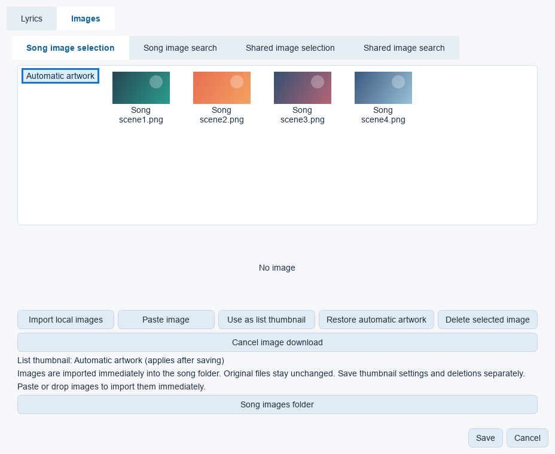
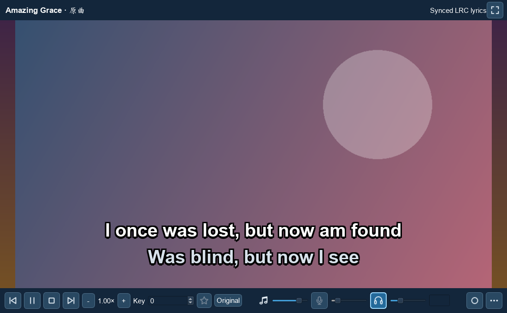

# Backgrounds

[English](BACKGROUNDS.md) · [繁體中文](BACKGROUNDS.zh-TW.md) · [日本語](BACKGROUNDS.ja.md)

Back to the [README](../README.md)

Background images rotate in random order while you sing. You can add your own images per song, or use images shared by all songs.

## Where backgrounds come from

Choose under **Settings → Karaoke background images**:

- **Song images only**: the music file's artwork and this song's image folder.
- **Shared and song images** (default): song images plus the shared images.
- **Shared images only**.

With no usable image, `no images` is shown. You can also enable **Gentle background motion** for a slight zoom and movement (the full image stays visible).

## Adding images to a song

Click the song's **Assets** → **Images** tab:

- **Song image selection**: paste or drop images; they are copied into the song folder and the originals stay unchanged. You can also pick one as the list thumbnail.
- **Song image search**: keywords default to the title and artist; search in your default browser, then drag or paste the chosen images onto the receiver bar at the top.
- **Shared images**: the same flow, but images go to the shared folder and are available to every song.

Supported formats: JPG, PNG, WebP and BMP; each image must be under 20 MB. Deleting images and thumbnail settings apply after **Save**.

## Shared background folder

The included shared backgrounds are copied on first use. Add your own images, or delete the defaults; your images are never overwritten. See [Background images](SUPPLEMENTARY.md#background-images) for the location and details.

## See also

These images can also be used in [Create an MV](MV_EXPORT.md). Use only images you are authorized to use.
