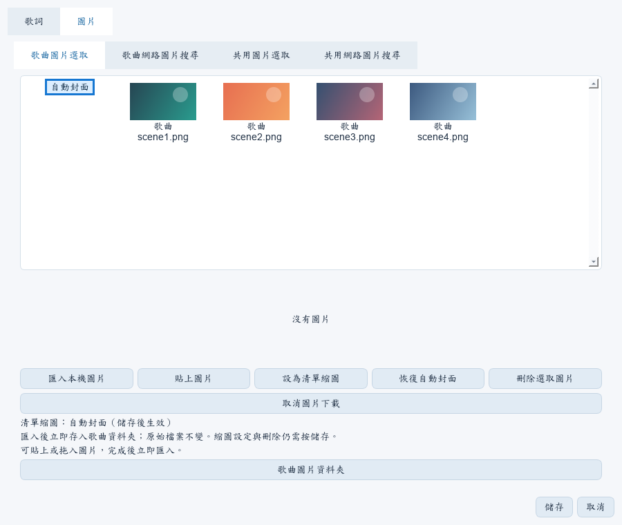
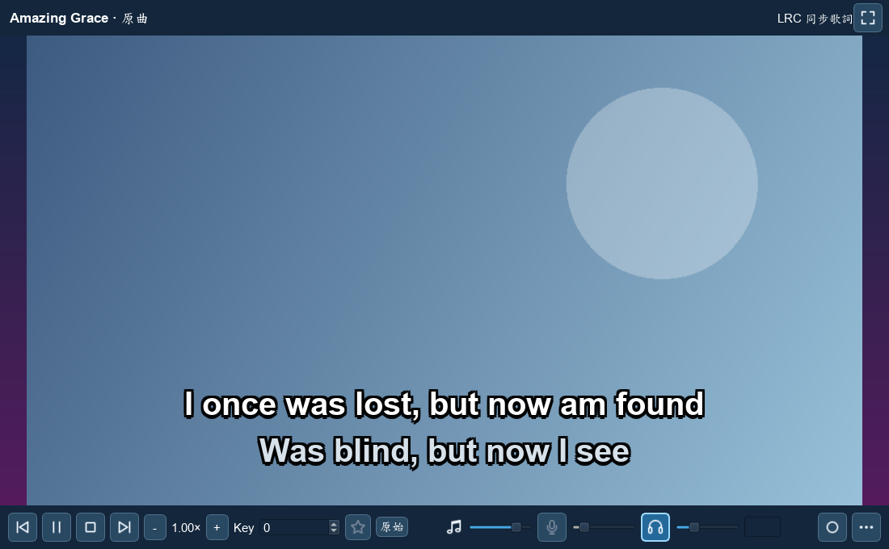

# 背景畫面

[English](BACKGROUNDS.md) · [繁體中文](BACKGROUNDS.zh-TW.md) · [日本語](BACKGROUNDS.ja.md)

回到 [README](../README.zh-TW.md)

唱歌時的背景圖會隨機輪播。你可以替每首歌放自己的圖，也可以使用所有歌曲共用的圖。
不同背景圖片切換時會以約兩秒交叉淡化；暫停播放時過渡也會暫停。

## 背景從哪裡來

在「設定」的「唱歌背景影像」選擇：

- **只用歌曲影像**：音樂檔封面與這首歌的圖片資料夾。
- **使用共用影像 + 目錄影像**（預設）：歌曲影像再加上共用影像。
- **只使用共用影像**。

沒有可用影像時會顯示 `no images`。也可以勾選「背景微動態」，讓圖片輕微縮放與移動（保留完整圖片）。

## 深度背景動畫（實驗）

1. 在「設定 → 模型與元件管理」勾選「背景深度動畫」，取消勾選不需要的其他模型，下載／修復模型，或匯入已有的 Depth Anything V2 Small 模型資料夾。這是選用下載，約 100 MB，模型管理會校驗檔案。
2. 確認風格轉換的執行元件已準備好；深度動畫使用同一個執行環境，不需下載 ACE-Step 模型。新設定預設開啟深度動畫；若曾關閉，可在設定展開「背景動畫設定」，勾選「背景微動態」和「深度背景動畫（實驗）」，按「儲存設定」。
3. 唱歌視窗上方顯示目前背景模式、深度處理狀態，深度模式會顯示 A3 方法及遮罩覆蓋率。首次處理每張圖時，播放繼續使用原本的背景動作；正在處理的當前圖片會最多等待約 25 秒，完成後至少顯示約 5 秒深度效果，再繼續輪播。處理結果快取於 `.app_data/cache/depth-motion`，相同圖片與模型可重複使用。切歌或圖片輪播時，前一張圖處理完成後會處理當前圖。關閉深度動畫或視窗會停止進行中的處理。

唱歌畫面中，模型未準備好、處理失敗或執行元件缺失時會回退到原本動作。此功能使用啟發式深度遮罩，不是真正的人物或景物辨識；可能選錯區域、顯示殘影，或讓地面動起來。第一次處理可能耗時且使用 GPU／CPU，若影響音訊請關閉。MV 匯出也可選擇使用深度動畫。

若想事先處理，停止播放後，在「處理歌曲」勾選歌曲並按「預處理背景動畫」，也可右鍵單首歌曲或版本選擇同一操作。程式依目前「唱歌背景影像」設定處理歌曲圖片、共用圖片及音樂封面；已快取的圖片會重用結果。歌曲「狀態」欄的綠色圖示表示目前圖片全部已處理，橙色表示部分已處理；滑鼠移到圖示可查看張數。進度與失敗圖片顯示於工作狀態，可按「取消處理」。後續更換圖片、模型或遮罩參數，需重新處理受影響的圖片。先前版本建立的快取可透過再次預處理快速建立狀態索引，無須重跑模型。每張未快取圖片目前會啟動一次模型程序，因此大量圖片可能需要較長時間。

展開的「背景動畫設定」可調整動作強度和速度、遮罩覆蓋上下限、人物與風景的遮罩擴張、以及遮罩實心化。最低覆蓋不可大於最高覆蓋。修改動作強度或速度會重用既有遮罩；修改覆蓋率、擴張或實心化則需要重新產生遮罩，避免使用舊設定的結果。

安裝、預處理、設定與 MV 匯出的完整步驟見[深度背景動畫](DEPTH_ANIMATION.zh-TW.md)。

## 替歌曲加圖片

按歌曲的「素材」→「圖片」分頁：

- **歌曲圖片選取**：貼上或拖入圖片，匯入後會複製到歌曲資料夾，原始檔案不變。也可以選一張當清單縮圖。
- **歌曲網路圖片搜尋**：關鍵字預設帶入歌名與歌手；用預設瀏覽器搜尋，把選好的圖拖曳或貼到上方的接收列。
- **共用圖片**：同樣的做法，但圖片會放進共用資料夾，所有歌曲都能使用。

支援 JPG、PNG、WebP、BMP；單張圖片需在 20 MB 以內。刪除圖片或縮圖設定需按「儲存」才會生效。

## 共用背景資料夾

內附的共用背景會在第一次使用時複製過去，你可以直接加入自己的圖，也可以刪掉預設圖，自訂圖片不會被覆蓋。位置與做法見[背景圖片](SUPPLEMENTARY.zh-TW.md#背景圖片)。

## 延伸

這些圖片也能用在[製作 MV](MV_EXPORT.zh-TW.md)。請只使用已取得必要授權的影像。
