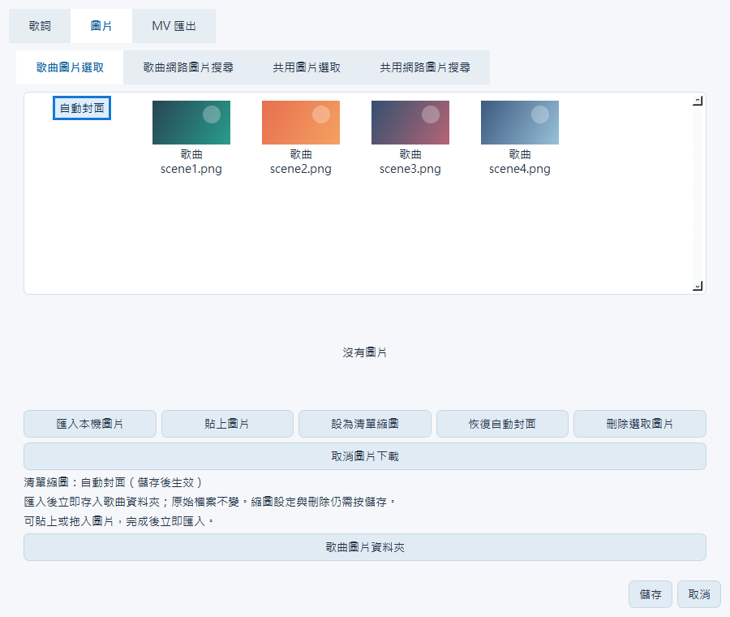

# 背景畫面

[English](BACKGROUNDS.md) · [繁體中文](BACKGROUNDS.zh-TW.md) · [日本語](BACKGROUNDS.ja.md)

回到 [README](../README.zh-TW.md)

唱歌時的背景圖會隨機輪播。你可以替每首歌放自己的圖，也可以使用所有歌曲共用的圖。

## 背景從哪裡來

在「設定」的「唱歌背景影像」選擇：

- **只用歌曲影像**：音樂檔封面與這首歌的圖片資料夾。
- **使用共用影像 + 目錄影像**（預設）：歌曲影像再加上共用影像。
- **只使用共用影像**。

沒有可用影像時會顯示 `no images`。也可以勾選「背景微動態」，讓圖片輕微縮放與移動（保留完整圖片）。

## 替歌曲加圖片

按歌曲的「素材」→「圖片」分頁：

- **歌曲圖片選取**：貼上或拖入圖片，匯入後會複製到歌曲資料夾，原始檔案不變。也可以選一張當清單縮圖。
- **歌曲網路圖片搜尋**：關鍵字預設帶入歌名與歌手；用預設瀏覽器搜尋，把選好的圖拖曳或貼到上方的接收列。
- **共用圖片**：同樣的做法，但圖片會放進共用資料夾，所有歌曲都能使用。

支援 JPG、PNG、WebP、BMP；單張圖片需在 20 MB 以內。刪除圖片或縮圖設定需按「儲存」才會生效。

## 共用背景資料夾

內附的共用背景會在第一次使用時複製過去，你可以直接加入自己的圖，也可以刪掉預設圖，自訂圖片不會被覆蓋。位置與做法見[背景圖片](SUPPLEMENTARY.zh-TW.md#背景圖片)。

## 延伸

這些圖片也能用在[製作 MV](MV_EXPORT.zh-TW.md)。請只使用已取得必要授權的影像。
