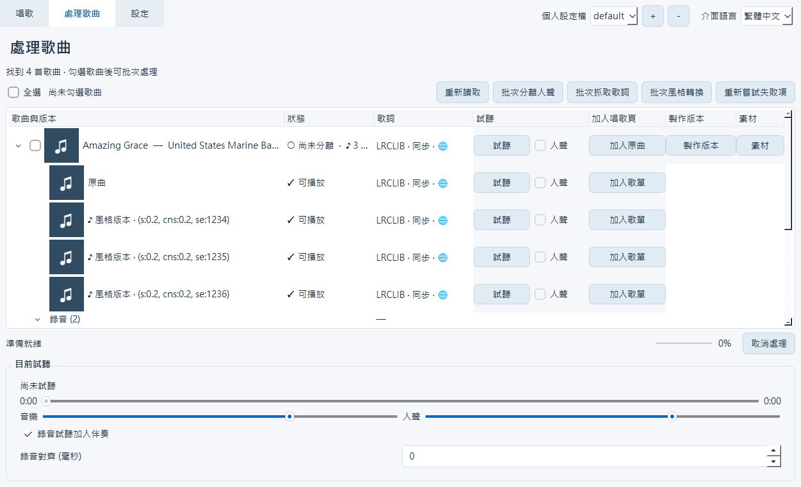

# 手持ちの MP3 をカラオケ音源に

[English](KARAOKE_TRACKS.md) · [繁體中文](KARAOKE_TRACKS.zh-TW.md) · [日本語](KARAOKE_TRACKS.ja.md)

[README](../README.ja.md) に戻る

KaraMorph は手持ちの曲をボーカルと伴奏に分離し、そのまま歌える「伴奏のみ」を作成します。カラオケに収録されるのを待つ必要はありません。

## 手順

1. 「設定」で音楽フォルダーを選び、「楽曲管理」で「曲を再読み込み」を押すと曲が一覧に出ます。
2. 曲を1つ以上選択し、「人声を一括分離」を押します。分離済みの曲は自動でスキップされます。
3. 完了後に曲を展開すると「伴奏のみ」が表示されます。「プレイリストに追加」を押して「歌う」で再生します。
4. 「原曲をプレイリストに追加」で、元の曲を歌うこともできます。

## ガイドボーカル

歌唱中に「ガイド」をオン／オフできます。分離したボーカルを歌の参考として流し、音量も調整できます。元の曲には独立したボーカルトラックがないため、元の曲ではガイドボーカルを使えません。

## ハードウェアとデータ

- ボーカル分離は NVIDIA GPU を優先します。VRAM が不足する場合や長い曲では、確認後に CPU を使えますが、時間と大量の RAM が必要です。詳しくは[ハードウェアとプラットフォーム](SUPPLEMENTARY.ja.md#ハードウェアとプラットフォーム)を参照してください。
- 処理結果は既定で `outputs/` に保存されます。曲の分離結果を削除しても、元の曲・歌詞・画像・録音・プレイリストは残ります。
- スタイルを変えたいときは [AI でアレンジ変更](STYLE_VERSIONS.ja.md)を参照してください。
