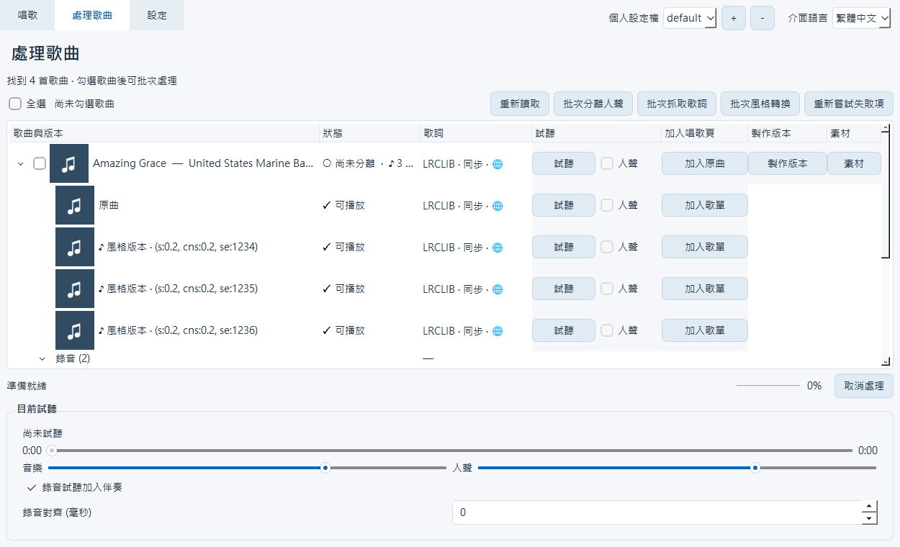

# Turn your own MP3s into karaoke tracks

[English](KARAOKE_TRACKS.md) · [繁體中文](KARAOKE_TRACKS.zh-TW.md) · [日本語](KARAOKE_TRACKS.ja.md)

Back to the [README](../README.md)

KaraMorph separates your own songs into vocals and backing, producing a "Backing only" track you can sing over, without waiting for a karaoke catalog to include the song.

## Steps

1. Choose your music folder in **Settings**, then click **Reload songs** in **Songs** to list your songs.
2. Check one or more songs and click **Separate vocals**. Songs that are already separated are skipped.
3. When it finishes, expand the song to find **Backing only**. Click **Add to playlist** to sing it in **Sing**.
4. You can also use **Add original to playlist** to sing the original recording.

## Guide vocals

While singing, you can switch **Guide vocals** on or off: the separated vocal acts as a reference, and its volume is adjustable. The original recording has no separate vocal track, so guide vocals are unavailable for it.

## Hardware and data

- Vocal separation prefers an NVIDIA GPU. With insufficient VRAM or a very long song you can switch to CPU after confirmation, which is slower and needs a lot of RAM. See [Hardware and platform](SUPPLEMENTARY.md#hardware-and-platform).
- Results are stored in `outputs/` by default. Deleting a song's separation results keeps the original, lyrics, images, recordings and playlist.
- To change the style, see [AI re-arrangement](STYLE_VERSIONS.md).
