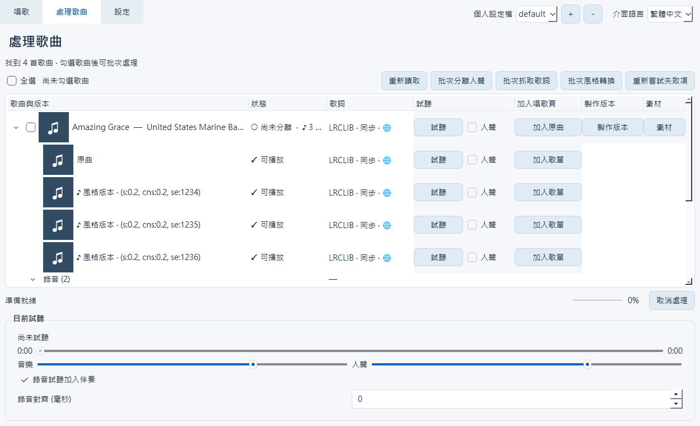

# 自己的 MP3 變卡拉 OK

[English](KARAOKE_TRACKS.md) · [繁體中文](KARAOKE_TRACKS.zh-TW.md) · [日本語](KARAOKE_TRACKS.ja.md)

回到 [README](../README.zh-TW.md)

KaraMorph 會把你自己的歌曲分離成人聲與伴奏，產生可直接演唱的「純伴奏」，不必等卡拉 OK 收錄。

## 步驟

1. 在「設定」選好音樂資料夾，回到「處理歌曲」按「重新讀取」，歌曲就會列出來。
2. 勾選一首或多首歌曲，按「批次分離人聲」。已經分離過的歌曲會自動跳過。
3. 完成後展開歌名，就能看到「純伴奏」。按「加入歌單」即可到「唱歌」播放。
4. 也可以直接用「加入原曲到歌單」唱原曲。

## 導唱

唱歌時可開關「導唱」：用分離出的人聲當作演唱參考，並可調整導唱音量。原曲本身沒有獨立的人聲音軌，因此原曲版本無法開啟導唱。

## 硬體與資料

- 人聲分離優先使用 NVIDIA GPU；VRAM 不足或歌曲太長時，確認後可改用 CPU，但時間較長且需要大量 RAM。細節見[硬體與平台](SUPPLEMENTARY.zh-TW.md#硬體與平台)。
- 處理結果預設放在 `outputs/`。刪除某首歌的分離結果時，原曲、歌詞、圖片、錄音與歌單都會保留。
- 想換個曲風，請看[AI 重新編曲](STYLE_VERSIONS.zh-TW.md)。
