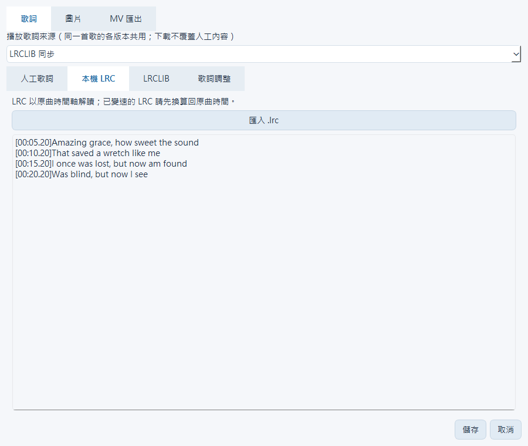

# 歌詞

[English](LYRICS.md) · [繁體中文](LYRICS.zh-TW.md) · [日本語](LYRICS.ja.md)

[README](../README.ja.md) に戻る

歌詞は自動検索、手入力、または自分の LRC の取り込みができます。LRC があると歌唱画面で1行ずつ同期表示されます。歌詞がなくても再生できます。

## 歌詞の入手

- **歌詞を一括取得**：「楽曲管理」で曲を選択して「歌詞を一括取得」を押すと LRCLIB に問い合わせます。送るのは曲の情報だけで、結果がある曲はスキップされ、アーティストがない曲は要確認と表示されます。
- **手動検索**：曲の「素材」→「歌詞」タブの「LRCLIB」サブタブで曲名・アーティストを入力して検索し、プレビューして適用します。
- **自分で入力**：「手入力歌詞」にテキストを貼り付けるか、「ローカル LRC」に `.lrc` を貼り付け／取り込みます（元の曲のタイムライン基準）。

## 再生に使う歌詞ソース

同じ曲のバージョンは1つの「再生歌詞ソース」を共有します：手入力テキスト、LRCLIB 同期、ダウンロードしたテキスト、ローカル LRC。ダウンロードで手入力の内容が上書きされることはなく、「保存」を押すと有効になります。適用した歌詞はローカルに保存されるため、再生にネットワークは不要です。

## 歌唱画面での表示

- LRC がある場合は1行ずつ同期表示され、歌唱画面で字幕を0.2秒ずつ遅らせたり早めたりできます。オフセットはバージョンごとに記憶されます。
- テキストのみの場合は、ボーカルの活動量からスクロールを推定します。精度は限定的です。

## タイミングのずれや抜けがある場合

[歌詞タイミング調整](LYRIC_TIMING.ja.md)で、音楽に合わせてスペースキーを押すと、テキストを LRC にしたり、既存の LRC を調整したり、足りない行を補ったりできます。
