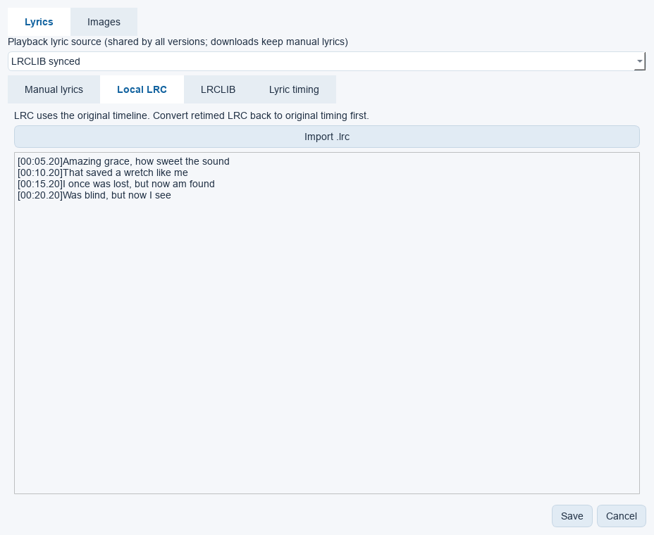

# Lyrics

[English](LYRICS.md) · [繁體中文](LYRICS.zh-TW.md) · [日本語](LYRICS.ja.md)

Back to the [README](../README.md)

Lyrics can be searched automatically, typed in, or imported as your own LRC. With an LRC the singing view follows the lyrics line by line. Playback also works without lyrics.

## Getting lyrics

- **Fetch lyrics**: check songs in **Songs** and click **Fetch lyrics** to query LRCLIB. Only song information is sent; songs that already have a result are skipped, and songs without an artist are flagged for review.
- **Manual search**: click the song's **Assets** → **Lyrics** tab, fill in the title and artist on the **LRCLIB** sub-tab, search, preview and apply.
- **Your own**: paste text under **Manual lyrics**, or paste or import a `.lrc` under **Local LRC** (original-song timeline).

## Playback lyric source

All versions of a song share one playback source: manual text, LRCLIB synced, downloaded plain text, or local LRC. Downloads never overwrite your manual lyrics, and changes apply after **Save**. Applied lyrics are stored locally, so playback works offline.

## In the singing view

- With an LRC, lines are highlighted in sync. Adjust timing in the song's Assets editor; previously saved per-version offsets remain in effect.
- With plain text only, scrolling is estimated from vocal activity and is approximate.

## Timing off or lines missing?

Use the [lyric timing editor](LYRIC_TIMING.md): tap Space along with the music to turn plain text into an LRC, re-time an existing LRC, or add missing lines.
