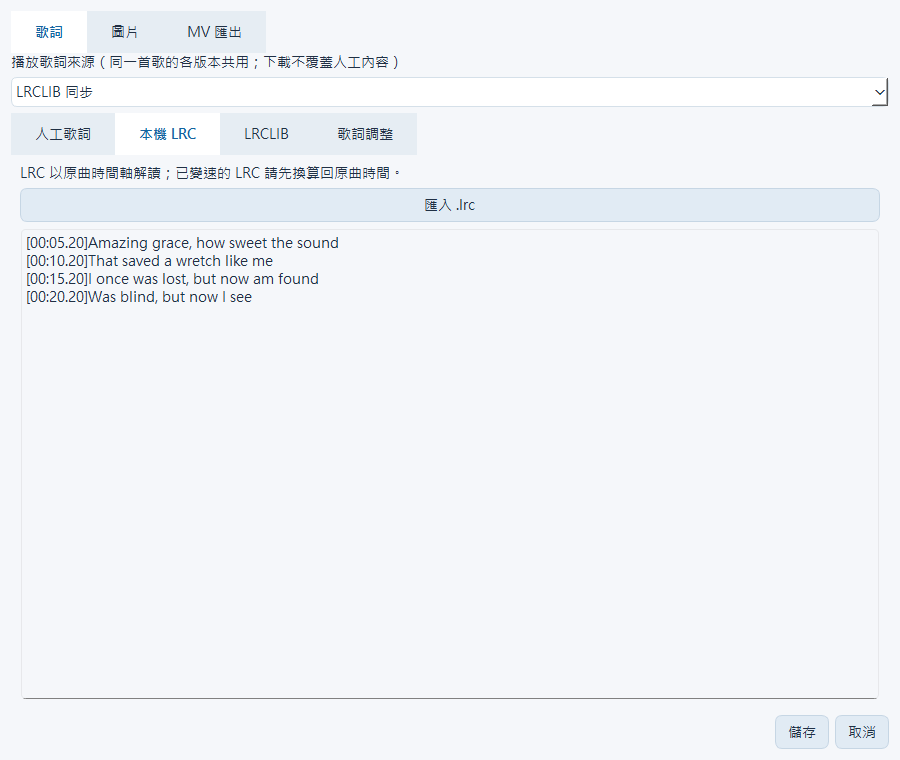

# 歌詞

[English](LYRICS.md) · [繁體中文](LYRICS.zh-TW.md) · [日本語](LYRICS.ja.md)

回到 [README](../README.zh-TW.md)

歌詞可以自動搜尋、手動輸入，或匯入自己的 LRC；有 LRC 時唱歌畫面會逐句同步顯示。沒有歌詞也能播放。

## 取得歌詞

- **批次抓取歌詞**：在「處理歌曲」勾選歌曲後按「批次抓取歌詞」，會向 LRCLIB 查詢。只傳送歌曲資訊，已有結果的歌曲會跳過；缺少歌手的歌曲會標示需要確認。
- **手動搜尋**：按歌曲的「素材」→「歌詞」分頁，在「LRCLIB」子分頁填寫歌名、歌手後搜尋，預覽後套用。
- **自己輸入**：在「人工歌詞」貼上文字，或在「本機 LRC」貼上／匯入 `.lrc`（以原曲時間軸為準）。

## 播放歌詞來源

同一首歌的各版本共用一個「播放歌詞來源」：人工純文字、LRCLIB 同步、下載純文字、本機 LRC。下載不會覆蓋你手動輸入的內容，按「儲存」後才會生效。套用後的歌詞存在本機，播放不需連線。

## 唱歌時的顯示

- 有 LRC 時逐句同步顯示，並可在唱歌視窗把字幕延後／提早 0.2 秒；偏移會依版本記住。
- 只有純文字時，會依人聲活動量估算捲動，準確度有限。

## 時間不準或缺句？

用[字幕校正](LYRIC_TIMING.zh-TW.md)跟著音樂按空白鍵，就能把純文字做成 LRC，或重新校正現有的 LRC，也能補上缺少的歌詞。
