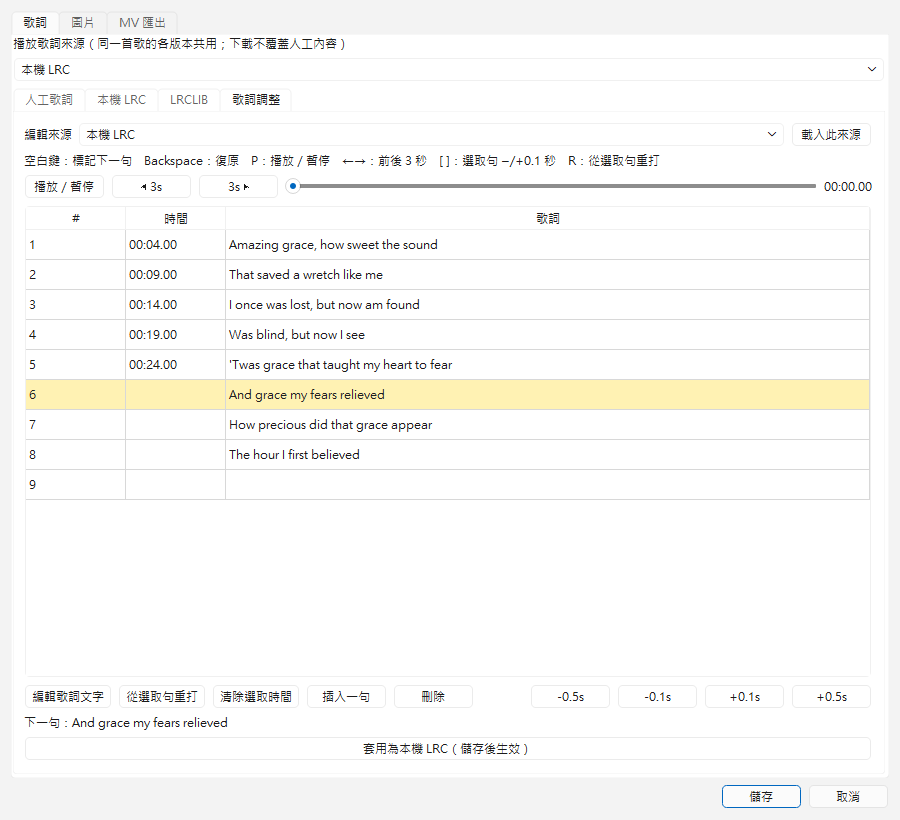

# 歌詞タイミング調整

[English](LYRIC_TIMING.md) · [繁體中文](LYRIC_TIMING.zh-TW.md) · [日本語](LYRIC_TIMING.ja.md)

[README](../README.ja.md) に戻る

音楽に合わせてスペースキーを押すだけで、テキストだけの歌詞を1行ずつの LRC にできます。LRCLIB から取得したものを含め、既存の LRC の再調整もできます。行単位で、単語ごとの時間合わせは不要です。

デモ曲：Amazing Grace（パブリックドメイン、[素材クレジット](ASSET_CREDITS.md)参照）。画面は繁体字中国語の UI です。

## 開き方

「楽曲管理」で曲の「素材」→「歌詞」タブ →「歌詞タイミング調整」を開きます。

## テキストから LRC を作る

1. 「編集するソース」で歌詞（手入力テキスト、LRCLIB 同期、ダウンロードしたテキスト、ローカル LRC）を選び、「このソースを読み込む」を押します。1行が1列になります。
2. **P** で元の曲を再生し、歌に合わせて **スペース** を順に押します。再生時間が黄色の行に記録され、次の行へ進みます。
3. 間違えたら **Backspace** で取り消します。その行の3秒前まで巻き戻ります。
4. 全行を記録したら「ローカル LRC として適用」を押し、ウィンドウ下の「保存」を押します。

結果は「ローカル LRC」に書き込まれ、再生ソースも自動で切り替わります。LRCLIB の取得ファイルや手入力の歌詞は変更されません。

## 微調整と区間の打ち直し

- 「時間」（`mm:ss.xx`）や「歌詞」のセルをダブルクリックして直接編集できます。
- 行を選択（Ctrl／Shift、Ctrl+A で全選択）し、`[`／`]` で −／+0.1 秒ずつずらせます。±0.5 秒のボタンもあります。押すのが遅かった場合は、全選択して前へずらします。
- 区間を打ち直すには、先頭の行を選んで **R** を押します。その行の3秒前から再生され、スペースで続きを記録し直せます。
- 「選択行の時間を消去」「行を挿入」「削除」もあります。

## 足りない歌詞を補う

ネットで見つけた歌詞は不完全なことがあります。「歌詞テキストを編集」を押すと別のテキストウィンドウが開きます。追加や修正をして OK を押してください。**変更していない行の時間は保持**され、追加した行だけ記録が必要です。作業中の内容は失われません。

## ショートカット

| キー | 動作 |
| --- | --- |
| スペース | 次の行を記録 |
| Backspace | 直前の記録を取り消し |
| P | 再生／一時停止 |
| ← → | 3秒戻る／進む |
| `[` `]` | 選択行を −/+0.1 秒 |
| R | 選択行から打ち直し |

## 注意

- 時間は元の曲のタイムラインが基準で、再生されるのは元の音声ファイルです。速度を変えたバージョンでは、バージョンの速度から自動換算されます。
- 適用した LRC は「保存」を押すと有効になります。
- すべての行に時間が必要で、前の行より早くはできません。違反があると、適用時に何行目か表示されます。
- 調整した LRC は [MV の書き出し](MV_EXPORT.ja.md)でも使われます。
