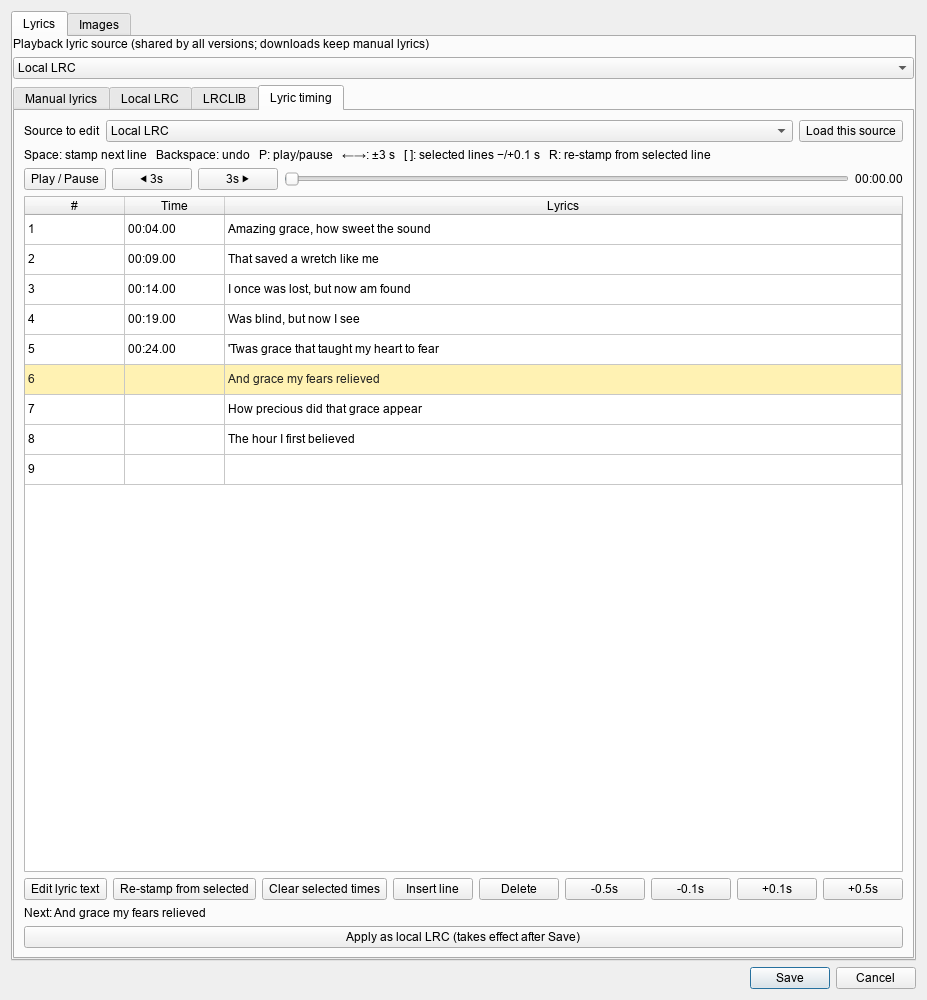

# Lyric timing editor

[English](LYRIC_TIMING.md) · [繁體中文](LYRIC_TIMING.zh-TW.md) · [日本語](LYRIC_TIMING.ja.md)

Back to the [README](../README.md)

Tap Space along with the music to turn plain-text lyrics into a line-by-line LRC, or re-time an existing LRC, including one downloaded from LRCLIB. Timing is per line; no per-word timing is needed.

Demo song: Amazing Grace (public domain, see [asset credits](ASSET_CREDITS.md)).

## Where to find it

In **Songs**, click a song's **Assets** → **Lyrics** tab → **Lyric timing**.

## Build an LRC from text

1. Pick a lyric source under **Source to edit** (manual text, LRCLIB synced, downloaded plain text, or local LRC) and click **Load this source**. Each line becomes one row.
2. Press **P** to play the original song, then press **Space** along with the singing. The current playback time is stamped onto the yellow row, which then moves to the next line.
3. Press **Backspace** to undo a stamp; the music rewinds 3 seconds before that line.
4. When every line is stamped, click **Apply as local LRC**, then **Save** at the bottom of the window.

The result is written to **Local LRC** and becomes the playback source. The LRCLIB download and your manual lyrics are left untouched.

## Fine-tuning and re-stamping a section

- Double-click a **Time** (`mm:ss.xx`) or **Lyrics** cell to edit it directly.
- Select one or more rows (Ctrl/Shift, or Ctrl+A) and press `[` / `]` to shift them by −/+0.1 s; ±0.5 s buttons are also provided. If you tapped too late, select all and move everything earlier.
- To redo a section, select its first row and press **R**: playback restarts 3 seconds before that line and you press Space to stamp the following lines again.
- You can also **Clear selected times**, **Insert line** and **Delete**.

## Adding missing lyrics

Lyrics found online may be incomplete. Click **Edit lyric text** to open a separate text window, add or fix the lines, and press OK. **Times of unchanged lines are kept**; new lines need to be stamped. Your work in progress is not lost.

## Keyboard shortcuts

| Key | Action |
| --- | --- |
| Space | Stamp the next line |
| Backspace | Undo the last stamp |
| P | Play / pause |
| ← → | Back / forward 3 s |
| `[` `]` | Selected rows −/+0.1 s |
| R | Re-stamp from the selected row |

## Notes

- Times use the original song's timeline and the original audio file is played; speed-changed versions are converted automatically from their version speed.
- The applied LRC takes effect only after you click **Save**.
- Every line needs a time, and no line may be earlier than the one before it; otherwise Apply tells you which line to fix.
- The corrected LRC is also used by [Create an MV](MV_EXPORT.md).
