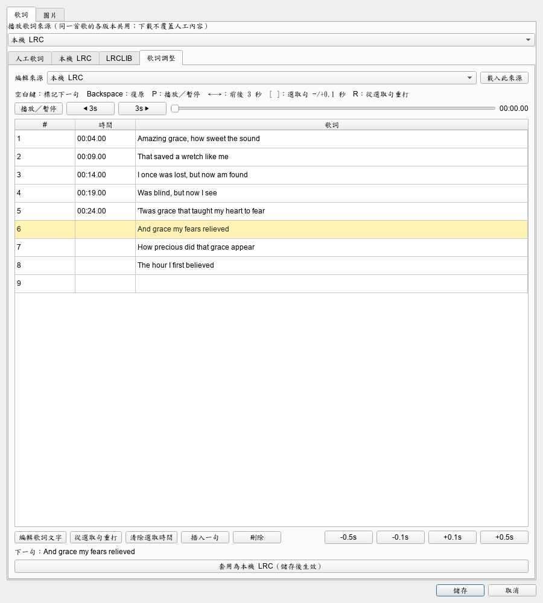

# 字幕校正（歌詞調整）

[English](LYRIC_TIMING.md) · [繁體中文](LYRIC_TIMING.zh-TW.md) · [日本語](LYRIC_TIMING.ja.md)

回到 [README](../README.zh-TW.md)

跟著音樂按空白鍵，就能把只有文字的歌詞變成逐句的 LRC；也能重新校正現有的 LRC，包含從 LRCLIB 抓下來的。以「句」為單位，不需要逐字對時間。

示範曲：Amazing Grace（公有領域，見[素材聲明](ASSET_CREDITS.md)）。

## 開啟方式

在「處理歌曲」按歌曲的「素材」→「歌詞」分頁 →「歌詞調整」。

## 從文字做出 LRC

1. 在「編輯來源」選要使用的歌詞（人工純文字、LRCLIB 同步、下載純文字、本機 LRC），按「載入此來源」。每一句會列成一列。
2. 按 **P** 開始播放原曲，跟著歌曲依序按**空白鍵**。目前播放時間會標到黃底那一句，並自動移到下一句。
3. 標錯時按 **Backspace** 復原，音樂會倒回該句前 3 秒。
4. 全部標完，按「套用為本機 LRC」，再按視窗下方的「儲存」。

結果會寫入「本機 LRC」，播放來源也會自動切過去；LRCLIB 原始檔與人工歌詞不會被改動。

## 微調與局部重打

- 雙擊「時間」（格式 `mm:ss.xx`）或「歌詞」欄位可直接修改。
- 選取一句或多句（可用 Ctrl／Shift，或 Ctrl+A 全選），按 `[`／`]` 整批 −／+0.1 秒；也有 ±0.5 秒按鈕。標得太慢時，全選再往前挪即可。
- 想重打某一段：選取起點那句按 **R**，會從該句前 3 秒開始播放，再依序按空白鍵重標。
- 還可以「清除選取時間」、「插入一句」、「刪除」。

## 補上缺少的歌詞

網路上找到的歌詞可能不完整。在調整畫面按「編輯歌詞文字」，會跳出另一個文字視窗，補上或修正文字後按 OK。**未改動句子的時間都會保留**，新增的句子需要再標記；調整中的內容不會因此消失。

## 快捷鍵

| 按鍵 | 功能 |
| --- | --- |
| 空白鍵 | 標記下一句 |
| Backspace | 復原上一次標記 |
| P | 播放／暫停 |
| ← → | 後退／前進 3 秒 |
| `[` `]` | 選取句 −／+0.1 秒 |
| R | 從選取句重打 |

## 注意

- 時間以原曲時間軸為準，播放的是原曲音檔；已變速的版本會依版本速度自動換算。
- 套用後的 LRC 要按「儲存」才會生效。
- 每一句都要有時間且不能比前一句早，否則套用時會提示是第幾句有問題。
- 校正好的 LRC 也會用在[製作 MV](MV_EXPORT.zh-TW.md)。
