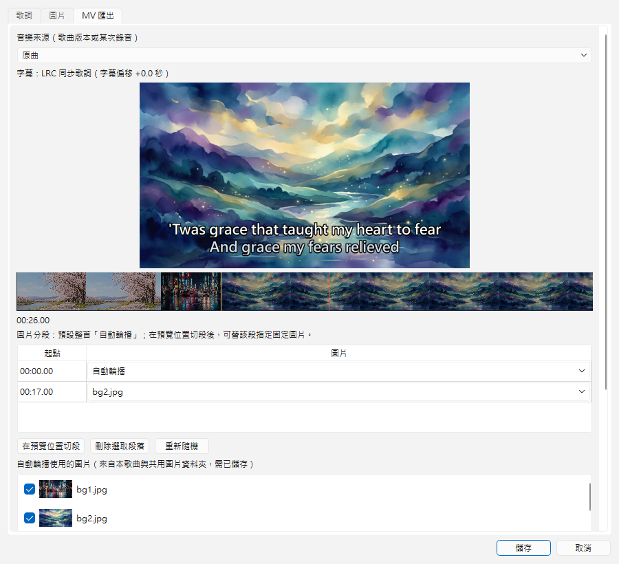
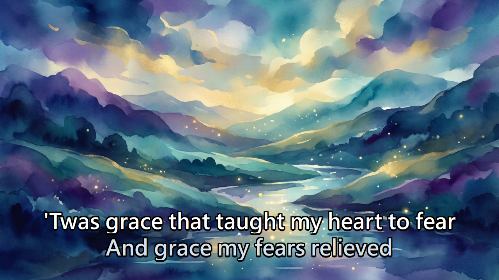

# MV の書き出し

[English](MV_EXPORT.md) · [繁體中文](MV_EXPORT.zh-TW.md) · [日本語](MV_EXPORT.ja.md)

[README](../README.ja.md) に戻る

曲のバージョンや自分の録音に、字幕と画像を合わせて MP4 に書き出します。たとえば歌を録音したあとに画像を選べば、完成した MV になります。

デモ曲：Amazing Grace（パブリックドメイン、[素材クレジット](ASSET_CREDITS.md)参照）。画面は繁体字中国語の UI です。

仕上がりの1コマ（現在の行と次の行を表示。背景画像は画面いっぱいになるようにトリミングされます）：

## 開き方

「楽曲管理」で曲の「素材」→「MV 書き出し」タブ（「歌詞」「画像」の隣）を開きます。

## 必要なもの

- 曲に **LRC のタイムライン** が必要です。テキスト歌詞は先に[歌詞タイミング調整](LYRIC_TIMING.ja.md)で時間を打って保存してください。
- MV には**保存済み**の歌詞・画像・字幕オフセットが使われます。変更した直後は先に「保存」を押してください。
- 内蔵 FFmpeg を準備するため、事前に分離または調整ジョブを一度実行しておく必要があります。

## 手順

1. **音源を選ぶ**：元の曲、伴奏のみ、調整／スタイル版、この曲の各録音が一覧に出ます。
   - 録音を選ぶと、あなたの声とその録音時の伴奏が1つにミックスされます。「ボーカル」と「伴奏」の音量を調整できます（既定は 1.0 と 0.7）。
2. **プレビュー**：上がプレビュー画面です。下の画像トラックの各ブロックが1つの画像シーンで、クリックすると任意の時間へ移動できます。
3. **画像を配置する**：
   - 既定では曲全体が「自動ローテーション」で、画像がランダムな順に切り替わり、クロスフェードします。1枚あたりの表示秒数を変えたり、「シャッフルし直す」で順序を作り直せます。
   - 特定の位置で画像を変えたいときは、その位置をプレビューして「プレビュー位置で分割」を押し、新しい区間に固定の画像を選ぶか、自動ローテーションのままにします。
   - 「自動ローテーションに使う画像」で使う画像を選びます。この曲のフォルダーと共有フォルダーの画像が対象です。
4. **出力設定**：解像度（540p／720p／1080p、30 fps）、字幕サイズ、字幕位置（下／中央）、現在行の色（白／黄／シアン）。
5. 「MV を書き出す…」を押して保存先を選びます。進捗が表示され、「書き出しをキャンセル」でいつでも中止できます（未完成のファイルは残りません）。

出力は MP4（H.264 映像、AAC 音声）です。

## 注意

- 録音中に歌唱画面でリアルタイムの速度／キーを変更した場合、録音にはバージョンしか記録されないため字幕がずれることがあります。字幕オフセットで調整してください。
- 書き出し中はメインウィンドウでフレームを描画するため、操作がやや重くなることがあります。長い曲や 1080p は時間がかかります。
- 使用する権利のある曲・歌詞・画像のみを使ってください。[ライセンスと法的注意](SUPPLEMENTARY.ja.md#ライセンスと法的注意)を参照してください。内蔵 FFmpeg のライセンスは[サードパーティ通知](../THIRD_PARTY_NOTICES.md)をご覧ください。
