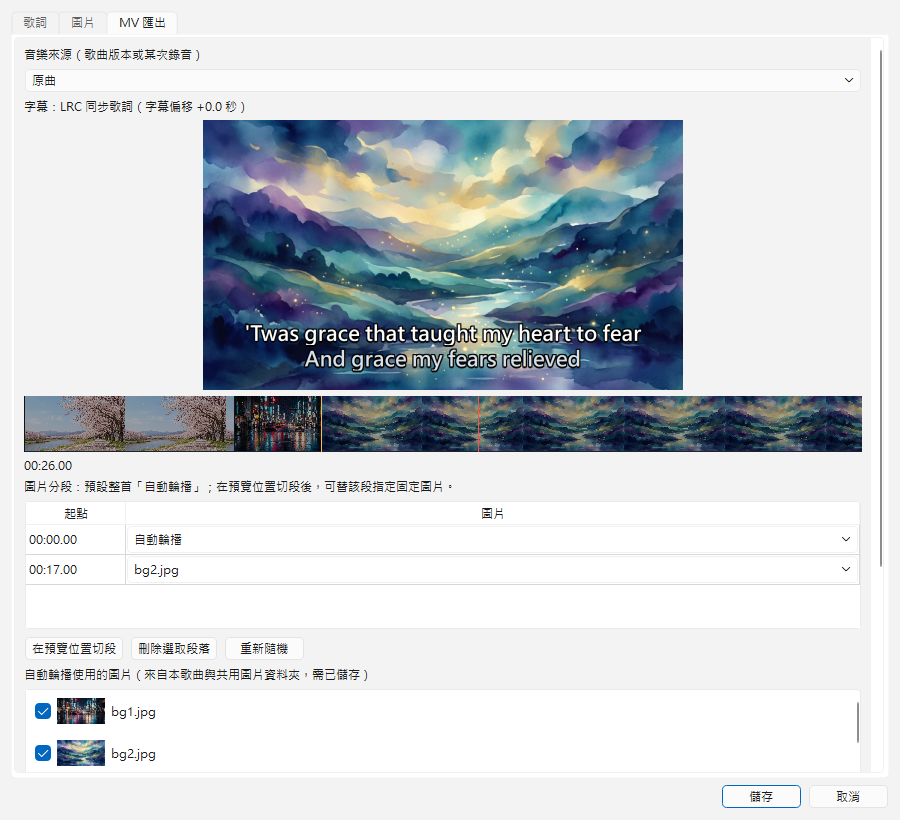
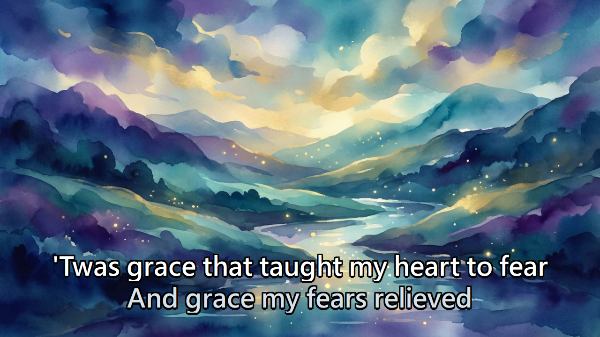

# Create an MV

[English](MV_EXPORT.md) · [繁體中文](MV_EXPORT.zh-TW.md) · [日本語](MV_EXPORT.ja.md)

Back to the [README](../README.md)

Combine a song version or your own recording with subtitles and images, and export an MP4. For example, record yourself singing, pick a few images, and turn it into a finished MV.

Demo song: Amazing Grace (public domain, see [asset credits](ASSET_CREDITS.md)). The screenshot shows the Traditional Chinese UI.

A sample frame of the result (the current and next lines are shown; background images are cropped to fill the frame):

## Where to find it

In **Songs**, click a song's **Assets** → **MV export** tab (next to **Lyrics** and **Images**).

## Requirements

- The song needs an **LRC timeline**. For plain-text lyrics, stamp them first with the [lyric timing editor](LYRIC_TIMING.md) and save.
- The MV uses **saved** lyrics, images and subtitle offsets; press **Save** first if you just changed them.
- Run a separation or adjustment job at least once beforehand so the bundled FFmpeg is ready.

## Steps

1. **Choose the music source**: the list shows the original, backing only, each adjusted/styled version, and every recording of this song.
   - For a recording, your vocal is mixed with the backing used in that take; adjust the **Vocal** and **Backing** levels (default 1.0 and 0.7).
2. **Preview**: the preview is at the top. Each block in the image track below is one image scene; click the track to jump to any time.
3. **Arrange images**:
   - By default the whole song **auto-rotates**: images appear in random order with crossfades. Set how long each stays, or click **Reshuffle**.
   - To change the image at a certain point, preview that point and click **Cut at preview position**, then pick a fixed image for the new segment or keep it on auto rotate.
   - Check or uncheck images under **Images used by auto rotate**. Images come from this song's folder and the shared folder.
4. **Output settings**: resolution (540p / 720p / 1080p, 30 fps), subtitle size, subtitle position (bottom / middle) and current-line color (white / yellow / cyan).
5. Click **Export MV…** and choose where to save. Progress is shown; **Cancel export** works at any time and leaves no partial file.

The output is an MP4 (H.264 video, AAC audio).

## Notes

- If you changed live speed/key in the singing window during a recording, subtitles may drift from the take because only the version was recorded. Use the subtitle offset to compensate.
- Frames are drawn in the main window during export, so the UI can feel slightly sluggish; long songs and 1080p take longer.
- Use only songs, lyrics and images you are authorized to use; see [License and legal notice](SUPPLEMENTARY.md#license-and-legal-notice). For the bundled FFmpeg's license, see the [third-party notices](../THIRD_PARTY_NOTICES.md).
