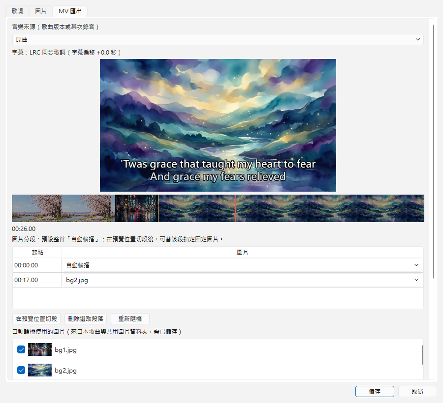
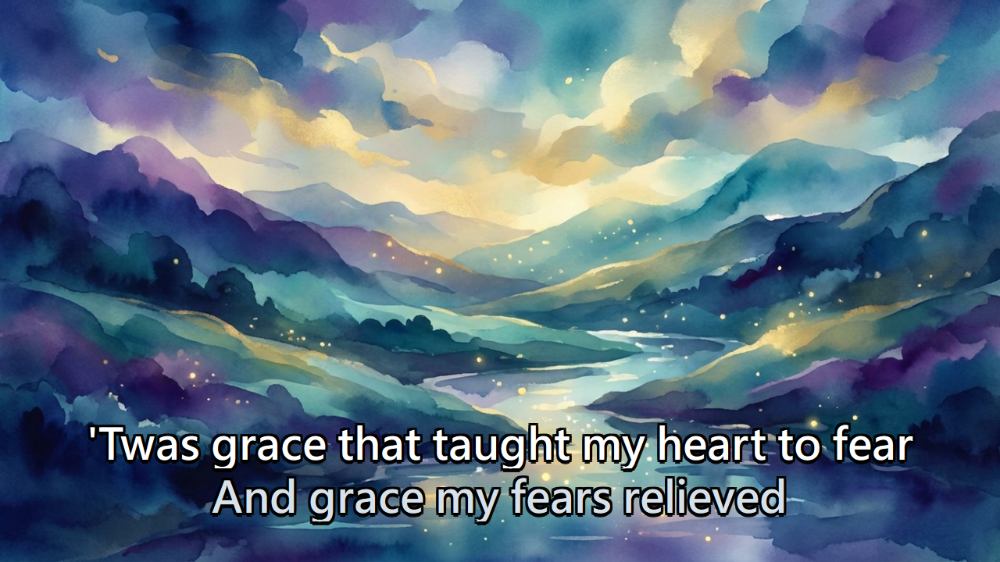

# 製作 MV

[English](MV_EXPORT.md) · [繁體中文](MV_EXPORT.zh-TW.md) · [日本語](MV_EXPORT.ja.md)

回到 [README](../README.zh-TW.md)

選一個歌曲版本或自己的錄音，搭配字幕與圖片，輸出成 MP4。例如唱完歌後找幾張圖，就能做成成品 MV。

示範曲：Amazing Grace（公有領域，見[素材聲明](ASSET_CREDITS.md)）。畫面為繁體中文介面。

成品畫面範例（字幕為目前句與下一句，背景圖會自動裁切填滿畫面）：

## 開啟方式

在「處理歌曲」按歌曲的「素材」→「MV 匯出」分頁（與「歌詞」、「圖片」並列）。

## 前置條件

- 歌曲需要有 **LRC 時間軸**。純文字歌詞請先用[字幕校正](LYRIC_TIMING.zh-TW.md)打好時間並儲存。
- MV 使用**已儲存**的歌詞、圖片與字幕偏移；剛修改的內容請先按「儲存」。
- 第一次使用前，需要曾經執行過一次分離或調整工作，讓內建的 FFmpeg 就緒。

## 步驟

1. **選音樂來源**：下拉選單列出原曲、純伴奏、各調整／風格版本，以及這首歌的每一次錄音。
   - 選錄音時，會把你的人聲和當次錄音的伴奏混成一軌，可調整「人聲」與「伴奏」音量（預設 1.0 與 0.7）。
2. **預覽**：上方是預覽畫面，下方的圖片軌每個色塊代表一個圖片場景，點圖片軌可跳到任何時間點看畫面。
3. **安排圖片**：
   - 預設整首「自動輪播」：圖片隨機輪流出現，場景之間有淡入淡出。每張停留的秒數可調，也能按「重新隨機」重新洗牌。
   - 想在某個位置換圖：預覽到該處，按「在預覽位置切段」，再替新的段落選固定圖片，或維持自動輪播。
   - 在「自動輪播使用的圖片」勾選或取消勾選要用的圖片。圖片來自本歌曲與共用圖片資料夾。
4. **輸出設定**：解析度（540p／720p／1080p，30 fps）、字幕大小、字幕位置（下方／中央）、目前句顏色（白／黃／青）。
5. 按「匯出 MV…」選擇存檔位置。畫面會顯示進度，可隨時按「取消匯出」，取消時不會留下未完成的檔案。

輸出為 MP4（H.264 影像、AAC 音訊）。

## 注意

- 錄音期間若在唱歌視窗調整過即時速度／Key，字幕可能與錄音對不上，因為錄音只記錄了版本。可以用字幕偏移微調。
- 匯出時影片逐格在主視窗繪製，操作介面可能稍有遲鈍；長歌與 1080p 需要較長時間。
- 請只使用已取得必要授權的歌曲、歌詞與圖片，詳見[授權與法律提醒](SUPPLEMENTARY.zh-TW.md#授權與法律提醒)。內建 FFmpeg 的授權也請見[第三方聲明](../THIRD_PARTY_NOTICES.md)。
