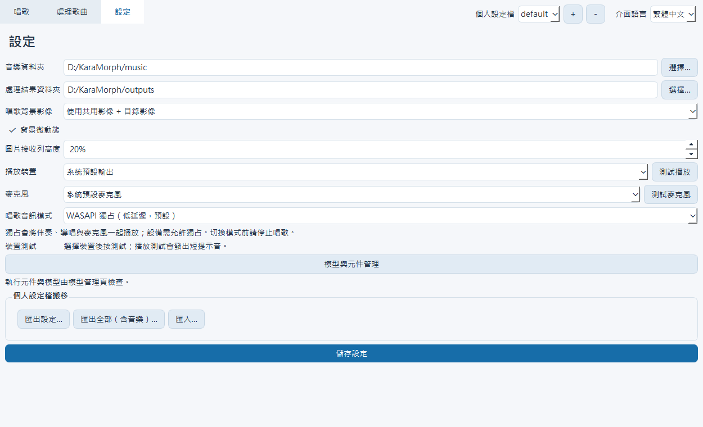

# プロファイル

[English](PROFILES.md) · [繁體中文](PROFILES.zh-TW.md) · [日本語](PROFILES.ja.md)

[README](../README.ja.md) に戻る

右上でプロファイルを追加・切り替えできます。人（や用途）ごとに自分の設定を保ちながら、同じ楽曲ライブラリを共有できます。

## プロファイルごとに保持されるもの

- 音量設定
- プレイリスト
- 曲ごとのベストな速度／キー（☆）
- 録音

楽曲ライブラリ、処理結果、歌詞・画像素材は共有されます。

## 使い方

- 右上の「プロファイル」メニューで追加・切り替え・削除ができます。切り替える前に再生を停止してください。
- プロファイルを削除すると、そのプレイリストとベスト設定は削除されますが、録音ファイルはディスクに残ります。
- プロファイル機能の導入前に録音したものは、既定のプロファイルに属します。

## 別の PC へ移す

「設定 → プロファイルの移行」で ZIP 1つに書き出せます。設定のみ、または音楽や素材も含めて移せます。詳しくは[ユーザーデータの移行](SUPPLEMENTARY.ja.md#ユーザーデータの移行)を参照してください。
