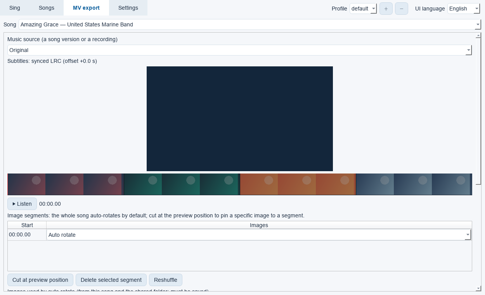

# Profiles

[English](PROFILES.md) · [繁體中文](PROFILES.zh-TW.md) · [日本語](PROFILES.ja.md)

Back to the [README](../README.md)

Add or switch profiles at the top right so each person (or purpose) keeps their own settings while sharing one song library.

## What each profile keeps

- Volume preferences
- Playlist
- Best speed / key for each song (☆)
- Recordings

The song library, processed results, lyrics and image assets are shared.

## How to use

- Use the **Profile** menu at the top right to add, switch or delete profiles. Stop playback before switching.
- Deleting a profile removes its playlist and best settings; recordings stay on disk.
- Recordings made before profiles existed belong to the default profile.

## Moving to another computer

Use **Settings → Move profile** to export a single ZIP, either settings only or together with music and assets. See [Moving user data](SUPPLEMENTARY.md#moving-user-data).
