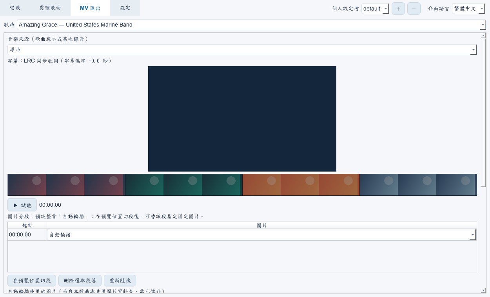

# 個人設定檔

[English](PROFILES.md) · [繁體中文](PROFILES.zh-TW.md) · [日本語](PROFILES.ja.md)

回到 [README](../README.zh-TW.md)

視窗右上角可以新增或切換個人設定檔，讓不同的人（或不同用途）各自保留自己的設定，共用同一個歌曲庫。

## 每個設定檔各自擁有

- 音量偏好
- 歌單
- 每首歌的最佳速度／Key（☆）
- 錄音

歌曲庫、處理結果、歌詞與圖片素材則是共用的。

## 操作

- 在右上角的「個人設定檔」選單可新增、切換或刪除設定檔。請先停止播放再切換。
- 刪除設定檔時，它的歌單與最佳設定會被刪除，錄音檔仍保留在磁碟上。
- 更早以前錄下的錄音，屬於預設設定檔。

## 搬移到另一台電腦

用「設定 → 個人設定檔搬移」匯出成一個 ZIP，可只帶設定，也可連同音樂與素材一起搬。詳見[資料搬移](SUPPLEMENTARY.zh-TW.md#資料搬移)。
