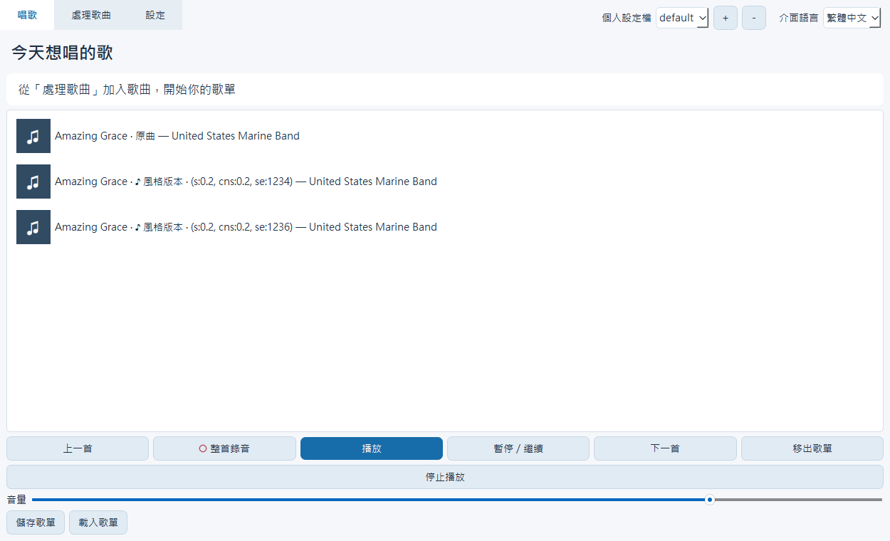
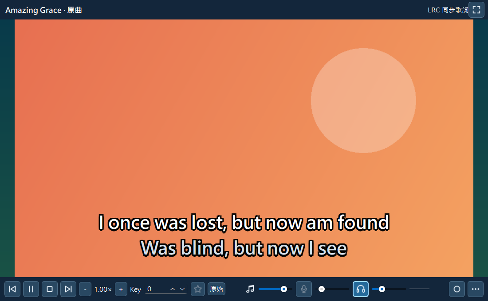

# プレイリストと録音

[English](SINGING_RECORDING.md) · [繁體中文](SINGING_RECORDING.zh-TW.md) · [日本語](SINGING_RECORDING.ja.md)

[README](../README.ja.md) に戻る

自分だけのプレイリストを作り、歌唱中にマイクで曲全体を録音できます。あとで聴き直したり、[MV](MV_EXPORT.ja.md) にしたりできます。

## プレイリスト

- 「楽曲管理」で「プレイリストに追加」を押すと、曲が「歌う」に表示されます。
- 「プレイリストを保存」でテキストファイルに書き出し、「プレイリストを読込」で再読み込みできます。前回のプレイリストは再起動時に自動で復元されます。
- 音源が見つからない項目は印が付き、再生時にスキップされます。ファイルが戻れば復元されます。「プレイリストから削除」でも音源は削除されません。

## 歌唱

- 歌唱中にガイドとマイクモニター（自分の声を聞く機能）をオン／オフし、音量も調整できます。
- リアルタイムの速度・キー変更は[再生速度とキー](SUPPLEMENTARY.ja.md#再生速度とキー)を参照してください。
- 「設定」で出力モードを選べます：WASAPI 排他（低遅延、既定）または共有（互換モード）。切り替える前に歌唱を停止してください。

## 曲全体の録音

プレイリスト画面で「再生時に録音」（曲全体の録音）をオンにすると、再生開始後に曲ごとにマイクの歌声が別々に録音されます。**再生前に設定する必要があり、再生中は切り替えられません。** 試聴を同期できるよう、実際に流れた伴奏も一緒に保存されるため、追加のディスク容量が必要です。

## 録音の試聴

「楽曲管理」で曲を展開すると、「録音（N）」の下に各録音が並び、「試聴」で再生できます。「録音の試聴に伴奏を追加」をオンにし、「録音の位置調整（ミリ秒）」で声と伴奏のずれを微調整できます。録音の削除も可能です。録音は現在の[プロファイル](PROFILES.ja.md)に属します。
