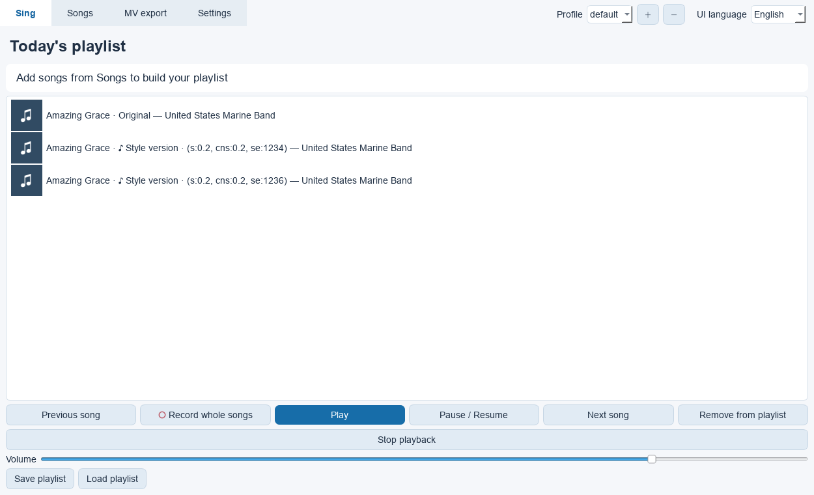
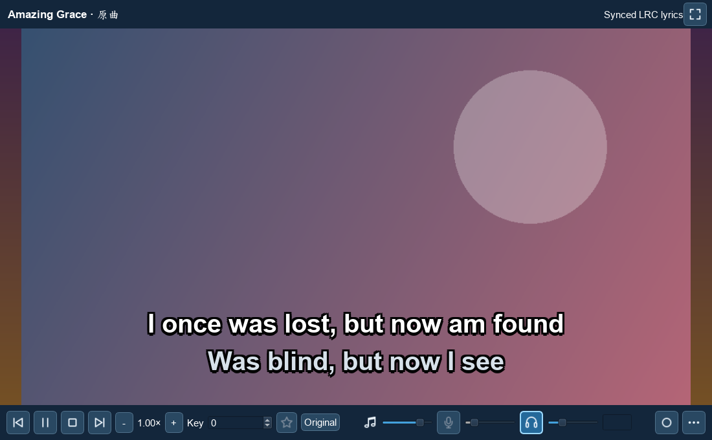

# Playlists and recording

[English](SINGING_RECORDING.md) · [繁體中文](SINGING_RECORDING.zh-TW.md) · [日本語](SINGING_RECORDING.ja.md)

Back to the [README](../README.md)

Build your own playlist, record your whole performance with a microphone while you sing, then listen back or turn it into an [MV](MV_EXPORT.md).

## Playlists

- Click **Add to playlist** in **Songs** and the song appears in **Sing**.
- **Save playlist** writes a text file and **Load playlist** reads it back; your last playlist is restored when you reopen the app.
- Items whose audio is missing are marked and skipped during playback, and recover when the file returns. **Remove from playlist** does not delete audio.

## Singing

- While singing you can toggle guide vocals and microphone monitoring (hearing yourself) and set their volumes.
- For live speed and key changes, see [Playback speed and key](SUPPLEMENTARY.md#playback-speed-and-key).
- In **Settings** you can choose the output mode: WASAPI exclusive (low latency, default) or shared (compatibility). Stop singing before switching.

## Whole-song recording

Turn on **Record on playback** (whole-song recording) in the playlist page, and each song is recorded from your microphone separately once playback starts. **Set it before playback; it cannot be toggled while playing.** The backing actually played is saved with the take so that previews stay in sync, which uses extra disk space.

## Previewing recordings

In **Songs**, expand the song; each take is listed under **Recordings (N)** with a **Preview** button. Tick **Include backing when previewing recordings** and use **Recording alignment (ms)** to fine-tune vocal and backing alignment. You can also delete a take. Recordings belong to the current [profile](PROFILES.md).
