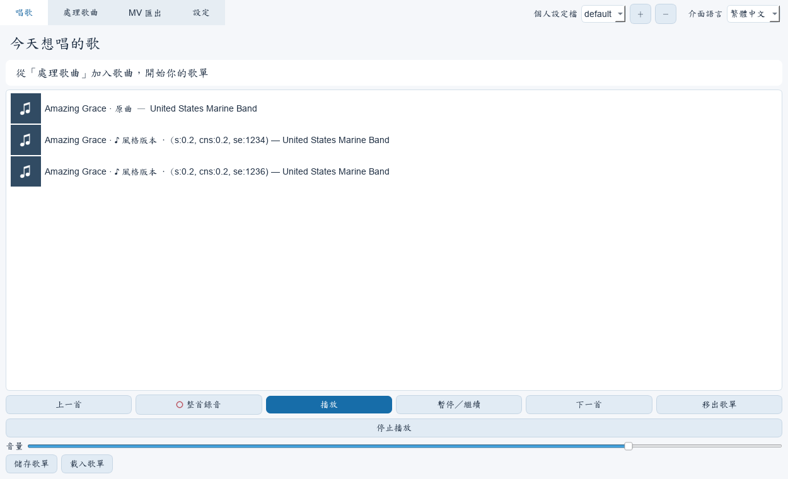
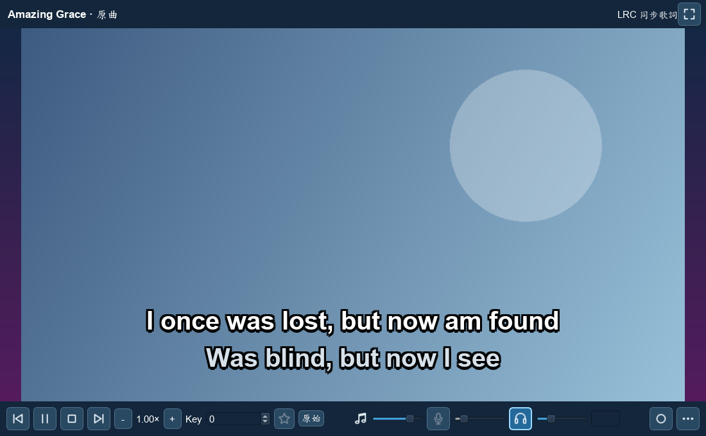

# 歌單與錄音

[English](SINGING_RECORDING.md) · [繁體中文](SINGING_RECORDING.zh-TW.md) · [日本語](SINGING_RECORDING.ja.md)

回到 [README](../README.zh-TW.md)

建立專屬歌單，唱歌時用麥克風錄下整首演唱，之後可以試聽，或做成 [MV](MV_EXPORT.zh-TW.md)。

## 歌單

- 在「處理歌曲」按「加入歌單」，歌曲會出現在「唱歌」。
- 「儲存歌單」會存成文字檔，「載入歌單」可再讀回來；上次的歌單會在重新開啟時自動還原。
- 找不到音檔的項目會被標記並在播放時跳過，原檔放回後可恢復。「移出歌單」不會刪除音檔。

## 唱歌

- 唱歌中可開關導唱與麥克風監聽（聽到自己的聲音），並各自調整音量。
- 即時調整速度與 Key 的方式見[播放速度與 Key](SUPPLEMENTARY.zh-TW.md#播放速度與-key)。
- 在「設定」可選輸出模式：WASAPI 獨占（低延遲，預設）或共用（相容模式）。切換前請先停止唱歌。

## 整首錄音

在歌單頁開啟「播放時錄音」（整首錄音），播放後每首歌會獨立錄下麥克風歌聲。**需在播放前設定，播放中不能切換**。錄音時也會保存當時實際播放的伴奏，之後試聽可以同步，所以會多佔一些磁碟空間。

## 試聽錄音

在「處理歌曲」展開歌名，「錄音 (N)」下列出每一次錄音，按「試聽」播放。可勾選「錄音試聽加入伴奏」，並用「錄音對齊（毫秒）」微調人聲與伴奏的對齊；也能刪除錄音。錄音屬於目前的[個人設定檔](PROFILES.zh-TW.md)。
