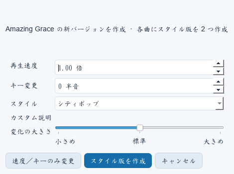

# AI でアレンジ変更

[English](STYLE_VERSIONS.md) · [繁體中文](STYLE_VERSIONS.zh-TW.md) · [日本語](STYLE_VERSIONS.ja.md)

[README](../README.ja.md) に戻る

同じ曲をラウンジジャズなどの別のスタイルに変更し、新しいバージョンとして保存します。元の曲と同じようにプレイリストに追加できます。

## 手順

1. まず曲の人声を分離します。
2. 曲の「バージョン作成」を押します。
3. 「スタイル」を選ぶか、「カスタムスタイル」を選んで説明を入力します。「変化の大きさ」（小さめ／標準／大きめ）で変化の幅を決められます。
4. 「スタイル版を作成」を押して完了を待ちます。AI 処理には時間がかかる場合があります。1回で1曲につき2つのバージョンが作られます。
5. 完了後に曲を展開し、新しいバージョンの「プレイリストに追加」を押します。

## 内蔵スタイル

シティポップ、フィンガースタイルギター、穏やかなピアノ、ラウンジジャズ、ブルース、アニメロック、ボサノヴァ、ローファイヒップホップ、映画風オーケストラ、シンセウェーブ。

## 一括処理ほか

- 複数の曲を選択して「一括スタイル変換」を押すと、まとめて処理できます。同種のジョブが待機中の曲はスキップされます。
- 「速度／キーのみ変更」では、速度やキーを固定した版を保存できます。歌唱中にリアルタイムで調整したい場合は[再生速度とキー](SUPPLEMENTARY.ja.md#再生速度とキー)を参照してください（新しいバージョンは作られません）。
- 使える NVIDIA GPU がない場合は CPU の使用を確認されます。時間がかかります。
- 生成したバージョンを削除しても元の曲は残ります。プレイリストの該当項目は利用不可と表示されます。
