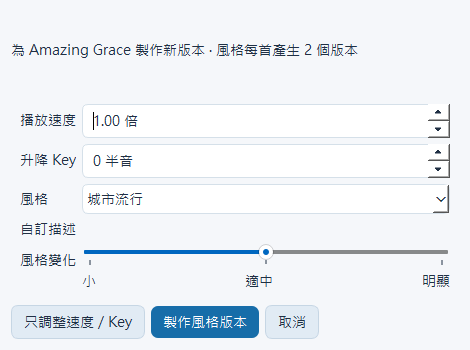

# AI re-arrangement

[English](STYLE_VERSIONS.md) · [繁體中文](STYLE_VERSIONS.zh-TW.md) · [日本語](STYLE_VERSIONS.ja.md)

Back to the [README](../README.md)

Turn the same song into a different style, such as lounge jazz, and keep the result as a new version that you can add to a playlist like the original.

## Steps

1. Separate the song's vocals first.
2. Click **Create version** beside the song.
3. Pick a **Style**, or choose **Custom style** and enter a description. **Style variation** (Subtle / Moderate / Strong) controls how far it departs from the original.
4. Click **Create style versions** and wait; AI processing can take a while. Each run creates 2 versions per song.
5. When it finishes, expand the song and click **Add to playlist** beside the new version.

## Built-in styles

City Pop, Fingerstyle Guitar, Gentle Piano, Lounge Jazz, Blues, Anime Rock, Bossa Nova, Lo-fi Hip-hop, Cinematic Orchestra and Synthwave.

## Batches and more

- Check several songs and click **Change style** to process them in one go. Songs that already have the same kind of job queued are skipped.
- **Change speed / key only** saves a version with a fixed speed or key. To adjust live while singing, see [Playback speed and key](SUPPLEMENTARY.md#playback-speed-and-key); that does not create a new version.
- Without a usable NVIDIA GPU you are offered CPU, which is slower.
- Deleting a generated version keeps the original; matching playlist entries are marked unavailable.
