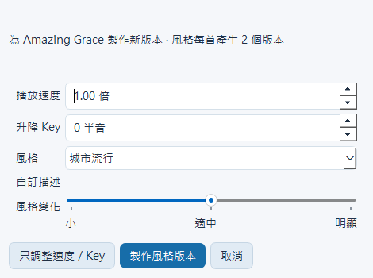

# AI 重新編曲

[English](STYLE_VERSIONS.md) · [繁體中文](STYLE_VERSIONS.zh-TW.md) · [日本語](STYLE_VERSIONS.ja.md)

回到 [README](../README.zh-TW.md)

把同一首歌改成不同的曲風，例如酒廊爵士，並保留成新的版本，可以像原曲一樣加入歌單。

## 步驟

1. 先對歌曲「分離人聲」。
2. 按歌曲右側的「製作版本」。
3. 在「風格」選一個曲風，或選「自訂風格」並輸入描述。可再用「風格變化」（小／適中／明顯）決定改變的幅度。
4. 按「製作風格版本」並等待完成。AI 處理可能需要較長時間。每首歌每次會產生 2 個版本。
5. 完成後展開歌名，在新版本右側按「加入歌單」。

## 內建風格

城市流行、指彈吉他、輕柔鋼琴、酒廊爵士、藍調、動漫搖滾、巴薩諾瓦、Lo-fi 嘻哈、電影管弦樂、合成器浪潮。

## 批次與其他

- 勾選多首歌曲後按「批次風格轉換」，可一次處理多首。同類工作已在佇列的歌曲會跳過。
- 「只調整速度／Key」可以另存一個固定速度或 Key 的版本；唱歌時想即時調整，請看[播放速度與 Key](SUPPLEMENTARY.zh-TW.md#播放速度與-key)，那不會製作新版本。
- 沒有可用的 NVIDIA GPU 時，會提示改用 CPU，速度較慢。
- 刪除生成版本不會刪除原曲；歌單中的對應項目會標示為無法使用。
